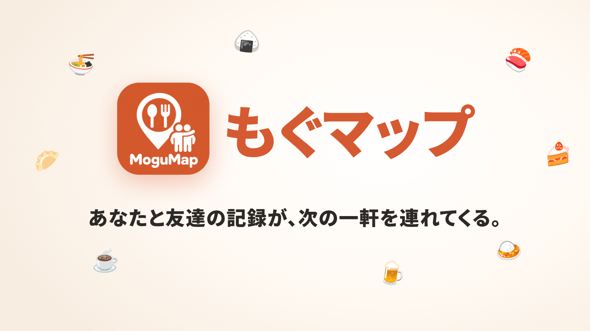
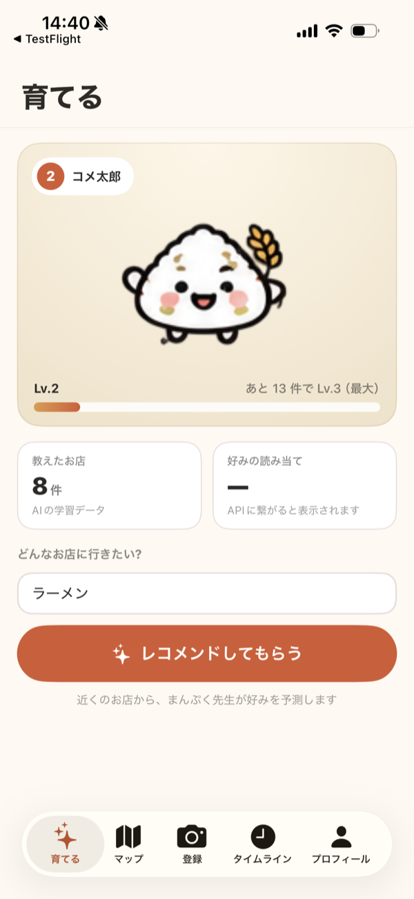
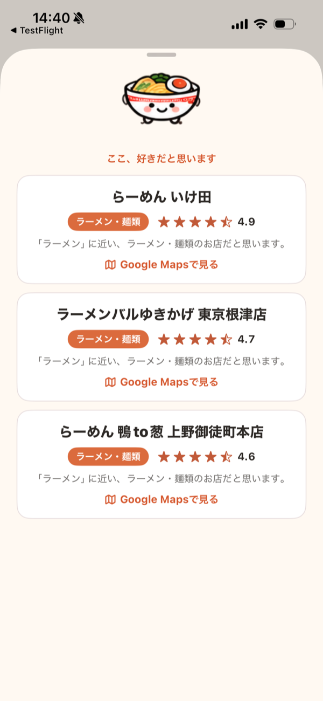
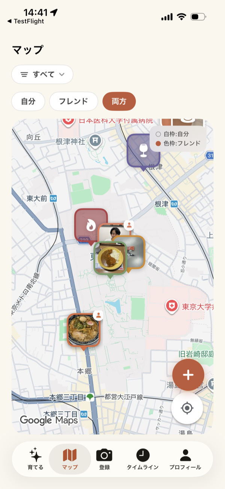
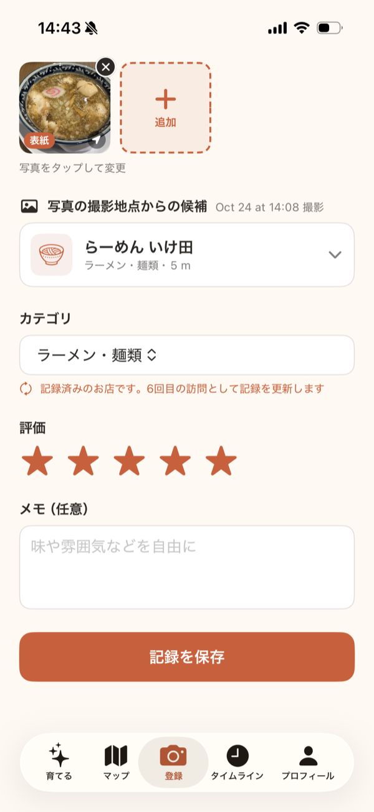
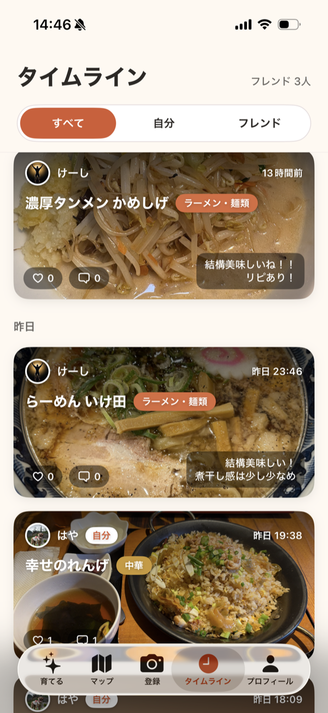

# もぐマップ — 写真を撮るだけで、友達と共有できる自分だけのグルメマップ

[](https://www.youtube.com/watch?v=piaNsc6ilBI)

▶ **PV動画**: [Google Drive で見る](https://drive.google.com/drive/folders/15Ywn2bS1_gblKCrfd140izWTkwb9y0Ll?usp=drive_link)

## 製品概要

写真を撮るだけでお店のレビューを記録でき、味の感覚が近い友達と共有できる iOS アプリです。
記録がたまるほど、自分の好みを学習した AI がお店をおすすめしてくれます。

## 背景

**「Google レビューや食べログを見ても、自分好みのお店がなかなか見つからない」**。
これが、私たちがもぐマップで解決したい課題です。

口コミサイトの評価は、不特定多数の平均点です。
味の濃さ、量、雰囲気、値段の感じ方は人によって違うので、平均点の高いお店が自分に合うとは限りません。

## 解決策: 2つの軸

この課題に対して、もぐマップは「平均点」の代わりに、**自分に合うものさし**でお店を選べるようにします。そのための軸が2つあります。

```
          課題: 口コミサイトでは、自分好みのお店が見つからない
                                │
            ┌───────────────────┴───────────────────┐
            ▼                                       ▼
  機能1: フレンドのおすすめ               機能2: 自分に特化した AI
  味の感覚・金銭感覚が近い                自分の評価と料理写真から好みを学び、
  友達の「良い！」で選ぶ                  気分に合うお店を予測する
            ▲                                       ▲
            └───────────────────┬───────────────────┘
                                │
          土台: 写真を撮るだけで、お店のレビューを記録できる
```

### 機能1: フレンドのおすすめ — 味の感覚が近い友達の「良い！」で選ぶ
私たちは、**本当に信頼できるお店**とは、味の感覚や金銭感覚が近い**友達が「良い！」とおすすめしたお店**だと考えています。
もぐマップでは、実際に行ったお店のレビューを友達と共有し、マップとタイムラインで友達のおすすめを見ながらお店を選べます。いいねやコメントで、友達と気軽にやり取りもできます。

### 機能2: 自分に特化した AI — 自分の好みを学習してお店を提案する
友達がまだ行っていないお店は、友達のおすすめでは選べません。
そこで、過去の来店履歴、レビューの評価、そして**料理写真の見た目の特徴**から好みを捉える **AI** が、行きたい気分に合うお店を、自分が付けそうな★の予測とともに提案します。
記録が少ないうちは Gemini が好みを推測し、記録がたまると**自分専用の機械学習モデル**に切り替わります。

### 土台: 写真を撮るだけのレビュー登録
2つの機能は、どちらも**記録がたまること**が前提です。友達と共有する情報も、AI の学習データも、記録から生まれます。
ところが、**レビューを書くのはめんどくさい**ものです。お店の名前を調べて、場所を登録して、カテゴリを選んで……という手間があると、記録は続きません。

だから私たちが最も大切にしたのは、**お店のレビュー登録の手軽さ**です。
もぐマップでは、**料理の写真を撮るだけで、お店の名前・場所・カテゴリ（ラーメンなのか、寿司なのか）が自動で登録されます**。
ユーザーが入力するのは、**5段階の評価**と、任意の**コメント**だけです。

1. **撮る**: お店で料理の写真を撮る（またはライブラリから選ぶ）
2. **選ぶ**: 写真の撮影位置から近くのお店が自動で選ばれる（違えば候補から選び直す）
3. **評価する**: ★を付けて保存する。コメントは任意

## 製品説明

アプリは5つのタブで構成されています（起動時はマップ）。

| タブ | できること |
|---|---|
| 育てる | 記録の数と傾向に応じてキャラクターが成長。気分を入力すると、AI が好みに合うお店を3軒おすすめ |
| マップ | 自分と友達が記録したお店を、写真入りのピンで地図に表示 |
| 登録 | 写真を撮る → 近くのお店が自動で選ばれる → ★評価とコメントを付けて保存 |
| タイムライン | 友達が直近3日間に行ったお店が新しい順に流れてくる。いいね・コメントができる |
| プロフィール | 自分の記録の写真グリッドと統計、プロフィール編集、フレンド・ブロックの管理 |

| 育てる | おすすめ結果 | マップ | 登録 | タイムライン |
|:---:|:---:|:---:|:---:|:---:|
|  |  |  |  |  |

## 特長

### 土台: 写真を撮るだけで、お店が自動で登録される

#### 撮影位置からお店を特定
写真の EXIF（撮影情報）から GPS の緯度・経度を読み取り、近くの飲食店を Google Places API の Nearby Search で探します。

- 検索条件: 半径 **1km**、種類は `restaurant` / `cafe`、**距離順**に最大 **5件**
- **一番近いお店を最初から選んだ状態**で表示します。違っていれば、距離（m）付きの候補一覧から選び直せます。
- 写真が複数あるときは、並び順で最初に位置情報を持つ写真（表紙を優先）の撮影位置を使います。
- 位置情報のない写真（アプリ内カメラで撮った写真など）では、**現在地**で検索します（取得のタイムアウトは15秒）。
- 撮影日時も EXIF の `DateTimeOriginal` から読み取ります。タイムゾーン情報（`OffsetTimeOriginal`）があれば考慮します。

#### カテゴリを13分類に自動で振り分け
Google Places が返すお店の種別（`primaryType` / `types`）から、アプリ独自の**13カテゴリ**に自動で分類します。

和食／ラーメン・麺類／焼肉・肉料理／中華／カレー／アジア・エスニック／洋食・西洋料理／ファストフード・食堂／カフェ・喫茶／パン／スイーツ／居酒屋・バー／その他

1. `primaryType` が具体的な種別（例: `ramen_restaurant`）なら、その分類を使う
2. `primaryType` が汎用的な種別（例: `restaurant`）なら、`types` の中から最初に当てはまる分類を探す
3. どれにも当てはまらなければ「その他」

#### 再訪問は自動でまとめる
同じお店（同じ Google のお店 ID）をもう一度記録すると、新しい記録は作らず、**訪問回数（リピート回数）を +1** し、★・コメント・カテゴリを最新の内容で更新して、写真を追加します。
登録画面にも「記録済みのお店です。N回目の訪問として記録を更新します」と表示されます。

#### 入力は★評価とコメントだけ
- 必須: 写真1枚以上、お店、カテゴリ（自動で入る）、★評価（1〜5）
- 任意: コメント
- 写真は1件につき最大 **10枚**。取り込み時に長辺 **2048px** に縮小し、アップロード時は JPEG 品質 **0.8** で圧縮します。
- 写真のアップロードに一部失敗しても、記録自体は保存されます。「写真を再送する」か「写真なしで完了する」を選べます。
- 保存すると、表紙写真・店名・★・「N回目の訪問・写真N枚」のカードが出ます。「続けて記録する」でカメラに戻り、「マップに戻る」で地図を開けます。

#### 料理写真の特徴を自動で抽出
写真を保存すると、裏で自動的に Gemini が料理の見た目（スープの濁り、背脂の量、麺の太さ、盛り付けなど）を解析し、JSON で保存します。ユーザーは何もする必要がありません。この特徴は、機能2の AI が好みを捉えるのに使います（詳細は「独自技術 6」）。

### 機能1: フレンドのおすすめ — 味の感覚が近い友達の「良い！」がわかる

#### フレンド申請と承認
- 各ユーザーには、英小文字・数字・`_` の **3〜20文字**の**ユーザー名**があります。初回登録時に10桁のランダムなユーザー名が自動で付き、プロフィール編集で変更できます。
- ユーザー名の**完全一致**で検索し、フレンド申請を送ります。相手が承認すると、お互いの記録が見えるようになります。
- 相手からすでに申請が来ている人に申請すると、その場でフレンドが成立します。
- 届いた申請の件数は、プロフィールタブのバッジに表示されます（アプリ起動時・復帰時に更新）。
- フレンド一覧から、友達のプロフィール（登録店舗数・最大リピート回数・最近の記録）を開けます。

#### マップで友達のお店を見る
Google Maps SDK for iOS の地図上に、自分と友達が記録したお店をピンで表示します。

- ピンは **56pt の角丸の写真**です。そのお店の1枚目の写真を表示し、写真がなければカテゴリの色とアイコンを表示します。
- **白い枠が自分**、**カテゴリ色の枠がフレンド**の記録です。
- 自分と友達の**両方が記録したお店**には、人のアイコンのバッジが付きます。
- 「自分／フレンド／両方」と、カテゴリ（13分類）で絞り込めます。
- ピンをタップすると、店名・カテゴリ・★評価・リピート回数・写真のカードが出ます。

#### タイムラインで友達の最新の記録を見る
- 友達（と自分）が**直近3日間**に記録したお店を、日付ごとに新しい順で表示します。
- 「すべて／自分／フレンド」で絞り込めます。時刻は「たった今」「N分前」「昨日 19:42」のように表示します。
- 投稿には**いいね**と**コメント**（1〜500文字）ができます。
- 友達がまだいないときは、フレンド探しに誘導します。

#### 公開範囲とブロックはデータベースで守る
「誰に見せるか」は、アプリのコードではなく、データベースの行単位のアクセス制御（**RLS**: Row Level Security）で制御しています。
- フレンドでない人の記録や写真は、データベースから取り出すこと自体ができません。
- タイムラインの投稿からユーザーを**ブロック**できます。ブロックすると、**お互いに**記録が見えなくなります。ブロック中のユーザーはプロフィールから確認・解除できます。

### 機能2: 自分に特化した AI — 記録するほど、自分専用の AI が育つ

#### 気分からのおすすめ（登録0件から使える）
「渋谷で静かなデート向けの和食」のような自由な言葉を入力すると、次の流れでおすすめを3軒出します。

1. **Gemini** で、入力を検索条件（カテゴリ・キーワード・検索文）に変換する。**店名は絶対に作らせない**
2. 検索条件と現在地で **Google Places Text Search** を呼び、実在するお店を最大 **10件**取得する（現在地から半径 3km を優先、写真付きのお店のみ）
3. 候補のお店それぞれに、自分が付けそうな★を予測する（記録数に応じて2つのモードを切り替える）
4. 予測★の高い **上位3件**を表示する。「Google Mapsで見る」でそのお店を開ける

| モード | 使う条件 | 予測のしかた |
|---|---|---|
| **Gemini モード** | 記録が0〜5件のとき。6件以上でも、自分専用モデルがまだ公開されていないとき | カテゴリごとの記録数と平均★、★を付けたお店の**料理写真の特徴**（新しい順に最大10店）を Gemini に渡し、候補の中から好みに合う3件と予測★を選ばせる。「評価の高いお店の料理に近い候補を優先し、低いお店に近い候補は避ける」と指示する |
| **自分専用モデル（LightGBM）モード** | 記録が6件以上で、学習済みのモデルが公開されているとき | 料理写真の CLIP 埋め込みと、カテゴリ・価格帯・Google の評価・過去の評価から、自分専用の LightGBM で★を予測する |

Gemini が返したお店が候補の中にあるか、★が1〜5か、3件以内かをサーバー側で検証し、条件を満たさない答えは使いません。

#### 自分専用モデルの学習（バックグラウンドで自動）
アプリを操作しなくても、記録が増えると裏で自動的に学習します。

- 記録や写真が追加・更新・削除されると、データベースのトリガーが「学習が必要なユーザー」として印を付けます。
- **Cloud Scheduler が5分ごと**に **Cloud Run Jobs** の学習ワーカーを起動し、印の付いたユーザーを最大10人ずつ学習します。
- 学習するのは、記録が **6件以上**あり、**初回**か、前回の学習から**新しいお店が5件以上**増えたときです。
- 学習したモデルは世代ごとに保存し、データベース側で検証してから公開します。失敗したときは指数バックオフで最大5回まで再試行します。

#### キャラクターの成長
登録したお店の数に応じて3段階に成長し、**一番多く記録しているカテゴリ**によって、成長後のキャラクターが変わります。全部で **8体**です。

| レベル | 必要な記録数 | キャラクター |
|---|---|---|
| Lv.1 | 0件〜 | もぐまる（全員共通） |
| Lv.2 | 6件〜 | コメ太郎 または ムギ郎 |
| Lv.3 | 21件〜 | スシ太郎／ラーメンマン／サケ次郎／ピザ郎／ケーキちゃん |

| 一番多いカテゴリ | Lv.2 | Lv.3 |
|---|---|---|
| 和食 | コメ太郎 | スシ太郎 |
| ラーメン・麺類、中華、アジア・エスニック | コメ太郎 | ラーメンマン |
| 焼肉・肉料理、居酒屋・バー、その他 | コメ太郎 | サケ次郎 |
| カレー | コメ太郎 | ピザ郎 |
| 洋食・西洋料理、ファストフード・食堂 | ムギ郎 | ピザ郎 |
| カフェ・喫茶、パン、スイーツ | ムギ郎 | ケーキちゃん |

- キャラクターは1体につき8コマの画像を **8fps** でコマ送りして動きます（iOS の「視差効果を減らす」設定がオンなら静止画）。
- おすすめの結果画面には、1位のお店のカテゴリに対応する Lv.3 のキャラクターが登場します。

#### AI の精度の見える化
自分専用モデルがどれくらい自分の好みを当てられるかを、「好みの読み当て」として表示します。

- 精度は **LOOCV**（記録を1件ずつ抜いて残りで学習し、抜いた1件の★を予測する検証方法）で測った**平均絶対誤差（MAE）**です。
- 表示は「**読み当て率 = (1 − MAE / 4) × 100 %**」と「**5段階で±0.xのズレ**」です。
- モデルが公開されるまでは「—」と表示します。

## 解決できること

- **口コミサイトでは見つからない、自分好みのお店に出会える**: 平均点ではなく、味の感覚が近い友達の評価（機能1）や、自分の好みを学習した AI（機能2）をもとにお店を選べます。
- **レビューが続かない問題を解消する**: 入力は★評価とコメントだけなので、食事のたびに気軽に記録できます。
- **行ったお店を忘れない**: 「あのおいしかったお店どこだっけ」を、写真入りの地図ですぐに振り返れます。

## 今後の展望

- **食の好みでつながる「食のマッチング」**: もぐマップには、ユーザー一人ひとりの食の好みに特化した AI モデルと、料理写真から抽出した見た目の特徴がたまっていきます。これを使って、まだ友達ではない人の中から**味の感覚や金銭感覚が近い人**を見つけ、つなげることを目指しています。「信頼できるのは、好みが近い人のおすすめ」という考えを、友達の外にも広げます。
- **友達と行くお店を、2人の好みから提案する**: それぞれの AI モデルの予測を組み合わせ、2人ともが満足しそうなお店を提案します。
- **学習開始の条件を見直す**: 現在は記録6件から自分専用モデルを学習していますが、精度を上げるため、**写真が20枚程度たまってから**学習を始める方針です。それまでは Gemini モードでおすすめします。
- **料理写真の特徴から好みの傾向を出す**: 保存している料理の特徴をユーザーごとに集計し、「こってり派」「トッピング多め派」といった好みの傾向を表示します。
- **Lv.3 到達後の楽しみ**: 最大レベルになった後も記録を続けたくなる仕組みを追加します。

## 注力したこと

### 1. レビュー登録の手軽さ
写真から店名・場所・カテゴリを自動で埋め、入力を★評価とコメントだけにしました。
一番近いお店を最初から選んだ状態にし、再訪問も自動でまとめるので、多くの場合は★を付けて保存ボタンを押すだけです。料理写真の解析も、保存後に裏で自動的に行います。
- [RecordCreateViewModel.swift](GourmetShareMap/Features/Record/ViewModels/RecordCreateViewModel.swift)
- [PhotoLocationReader.swift](GourmetShareMap/Services/PhotoLocationReader.swift)
- [FindNearestShop.swift](GourmetShareMap/Services/Places/FindNearestShop.swift)
- [PlaceCategoryClassifier.swift](GourmetShareMap/Services/Places/PlaceCategoryClassifier.swift)
- [RecordStore.swift](GourmetShareMap/Core/RecordStore.swift)

### 2. AI に店名を作らせない
生成 AI にお店を直接答えさせると、存在しないお店を作ってしまうことがあります。
そこで Gemini には「検索条件への変換」と「実在する候補の中からの選択」だけを任せ、お店そのものは Google Places から取得します。Gemini の答えは、候補に含まれるかどうかをサーバー側で検証します。
- [mogumap_clip_lgbm/recommend.py](mogumap_clip_lgbm/recommend.py)

### 3. 記録0件からおすすめでき、記録が増えるほど自分専用になる AI
機械学習モデルは、データが少ないと学習できません。そこで、記録が少ないうちは Gemini が好みを推測し、6件以上たまったら自分専用の LightGBM に切り替える2段構えにしました。
LightGBM 側は、写真の特徴抽出（CLIP）を全員で共有し、ユーザーごとには軽い回帰モデルだけを学習します。評価も、データが少なくても安定する LOOCV を採用しています。
- [mogumap_clip_lgbm/api.py](mogumap_clip_lgbm/api.py)
- [mogumap_clip_lgbm/ml.py](mogumap_clip_lgbm/ml.py)
- [mogumap_clip_lgbm/policy.py](mogumap_clip_lgbm/policy.py)

### 4. 料理写真の見た目を、集計できるデータにする
「好み」を写真の見た目からも捉えるため、料理写真の特徴を Gemini で抽出して JSON で保存し、おすすめの入力に使っています。
自由な文章ではなく、カテゴリごとに定義した選択肢と段階評価だけで答えさせるので、ユーザー単位で比較・集計できます。
- [supabase/functions/analyze-dish/](supabase/functions/analyze-dish/)
- [supabase/DISH_ANALYSIS.md](supabase/DISH_ANALYSIS.md)

### 5. API キーと個人のデータを守る
- AI バックエンドや Gemini のキーはアプリに埋め込まず、Supabase Edge Function を経由して呼び出します。
- 記録・写真・コメント・いいね・AI の学習状況の公開範囲は、すべて RLS と Storage のポリシーで制御しています。
- 有料 API を使う AI バックエンドには、1分あたりの回数制限を設けています。
- [supabase/migrations/](supabase/migrations/)
- [supabase/functions/ai-recommend/index.ts](supabase/functions/ai-recommend/index.ts)

## 開発技術

### 技術スタック

| 分類 | 技術 |
|---|---|
| iOS アプリ | Swift / SwiftUI、Observation、AuthenticationServices（Sign in with Apple）、Core Location、AVFoundation、PhotosUI、ImageIO |
| Swift Package | supabase-swift 2.55.4、ios-maps-sdk 11.2.0 |
| 地図・お店 | Google Maps Platform（Maps SDK for iOS、Places API (New): Nearby Search / Text Search / Place Details） |
| バックエンド | Supabase（Auth / PostgreSQL / Storage / Edge Functions / Database Webhooks） |
| AI バックエンド | Python 3.12、FastAPI、uvicorn、sentence-transformers（CLIP `clip-ViT-B-32`）、LightGBM、google-genai |
| 生成 AI | Vertex AI Gemini `gemini-3.8-flash`（おすすめの検索条件・Gemini モードの推薦）、Gemini API `gemini-3.5-flash-lite`（料理写真の特徴抽出） |
| インフラ | Google Cloud Run（API）、Cloud Run Jobs（学習ワーカー）、Cloud Scheduler（5分ごとの起動）、Cloud Storage（モデル保存）、Supabase Edge Functions（Deno / TypeScript） |
| CI | GitHub Actions（`main` への push / PR で、iOS のテストを iPhone シミュレーターで実行） |
| デバイス | iPhone（iOS 26.5 以降） |

### システム構成

```
[iPhone アプリ（Swift / SwiftUI）]
   │
   ├─ Sign in with Apple ───────────────▶ Supabase Auth
   │
   ├─ 記録・写真・フレンド・コメント ──▶ Supabase PostgreSQL / Storage（RLS で公開範囲を制御）
   │                                          │
   │                                          ├─ 写真の保存（image INSERT）
   │                                          │    └─▶ Database Webhook ─▶ Edge Function: analyze-dish
   │                                          │                              └─▶ Gemini API（料理の特徴 → image.dish_features）
   │                                          │
   │                                          └─ 記録・写真の変更 ─▶ トリガーで「学習が必要」の印
   │                                                                   ▲
   │                       Cloud Scheduler（5分ごと）─▶ Cloud Run Jobs: 学習ワーカー
   │                                                    ├─ 記録と写真を読み、CLIP + LightGBM で学習
   │                                                    ├─▶ Cloud Storage（モデルを世代ごとに保存）
   │                                                    └─▶ ai_model_status に公開
   │
   ├─ 地図表示・お店の候補検索 ─────────▶ Google Maps SDK / Google Places API
   │
   └─ AI おすすめ ─▶ Edge Function: ai-recommend（記録・写真・料理の特徴を集める）
                       └─▶ Cloud Run: FastAPI /recommend
                              ├─▶ Vertex AI Gemini（気分 → 検索条件、Gemini モードの推薦）
                              ├─▶ Google Places Text Search（候補のお店）
                              └─▶ 公開済みモデルがあれば LightGBM で★を予測
```

## 独自技術

### 1. 写真からのお店の自動特定
写真の EXIF から GPS 座標を読み取ります。南緯・西経（Ref が `S` / `W`）は符号を反転し、`(0, 0)` などの不正な座標は位置なしとして扱います。
その座標で Places API の Nearby Search を呼び、距離順の先頭を自動で選びます。

```json
// POST https://places.googleapis.com/v1/places:searchNearby
// X-Goog-FieldMask: places.id,places.displayName,places.location,places.primaryType,places.types
{
  "languageCode": "ja",
  "includedTypes": ["restaurant", "cafe"],
  "maxResultCount": 5,
  "rankPreference": "DISTANCE",
  "locationRestriction": { "circle": { "center": { "latitude": 35.71, "longitude": 139.76 }, "radius": 1000.0 } }
}
```

新しいお店では Place Details（`rating` / `priceLevel` / `userRatingCount`）も取得し、AI の学習用に保存します。
価格帯は `FREE`・`INEXPENSIVE` → 1、`MODERATE` → 2、`EXPENSIVE` → 3、`VERY_EXPENSIVE` → 4 に変換します。
- [PhotoLocationReader.swift](GourmetShareMap/Services/PhotoLocationReader.swift)
- [FindNearestShop.swift](GourmetShareMap/Services/Places/FindNearestShop.swift)
- [FindPlaceDetails.swift](GourmetShareMap/Services/Places/FindPlaceDetails.swift)

### 2. 13カテゴリへの自動分類
分類のルールは、優先順位つきの配列で持っています。

```swift
static func category(primaryType: String?, types: [String]) -> String {
    // 主カテゴリが具体的なら優先する。汎用のrestaurant等は詳細typesで補完する。
    let specificRules = categoryRules.dropLast()
    if let primaryType,
       let rule = specificRules.first(where: { $0.types.contains(primaryType) }) {
        return rule.name
    }
    let typeSet = Set(types)
    return specificRules.first(where: { !$0.types.isDisjoint(with: typeSet) })?.name ?? "その他"
}
```
- [PlaceCategoryClassifier.swift](GourmetShareMap/Services/Places/PlaceCategoryClassifier.swift)

### 3. 写真入りのマップピン
SwiftUI で作ったピン（`ShopPinView`）を `ImageRenderer` で画像にし、Google Maps のマーカーに使っています。

- 見た目の組み合わせ（写真・カテゴリ・自分かフレンドか・選択中か）ごとにピン画像をキャッシュし、変わったマーカーだけを更新します。
- 写真は1枚目を署名付き URL で取得し、**168px**（56pt の3倍）に縮小して使います。並列に取得し、写真のないお店は再取得しません。
- 自分と友達の両方が記録したお店は、`google_place_id` の積集合で判定してバッジを付けます。
- [GoogleMapView.swift](GourmetShareMap/Features/Map/Views/GoogleMapView.swift)
- [ShopPinView.swift](GourmetShareMap/Features/Map/Components/ShopPinView.swift)
- [StorePhotoLoader.swift](GourmetShareMap/Features/Map/ViewModels/StorePhotoLoader.swift)
- [MapViewModel.swift](GourmetShareMap/Features/Map/ViewModels/MapViewModel.swift)

### 4. ユーザーごとの個別 AI モデル（LightGBM モード）
1件の記録を、次の特徴量に変換して LightGBM で★を予測します。

| 特徴量 | 内容 |
|---|---|
| `google_rating`、`review_count_log`、`price_level` | Google の評価、レビュー数（log1p）、価格帯 |
| `cat_0` 〜 `cat_12` | 13カテゴリの one-hot |
| `hist_count`、`hist_avg`、`cat_hist_avg` | その時点までの評価件数、平均★、同じカテゴリの平均★ |
| `liked_image_similarity` | ★4以上を付けた写真の平均ベクトルとのコサイン類似度 |
| `disliked_image_similarity` | ★2以下を付けた写真の平均ベクトルとのコサイン類似度 |
| `clip_000` 〜 | 料理写真の CLIP 埋め込み |

- 学習データは記録を時系列に並べ、**各記録より前の評価だけ**を履歴として特徴量を作ります（未来の情報を使わない）。
- CLIP（`sentence-transformers/clip-ViT-B-32`）は学習せず、全ユーザーで共有します。重みは Docker イメージに含め、オフラインで動かします。
- LightGBM のハイパーパラメータは、データ数 `n` に応じて調整しています。

```python
LGBMRegressor(
    n_estimators=min(150, max(20, 6 * n)),
    learning_rate=0.1,
    num_leaves=max(2, min(15, n)),
    max_depth=4,
    min_child_samples=1,
    min_split_gain=0,
    random_state=42,
)
```
- 精度は直近 **15件**までの LOOCV で測り、予測値を 1〜5 に収めてから MAE を計算します。
- モデルは Cloud Storage の `models/{user_id}/{model_version}/model.joblib` に世代ごとに保存します。
- [mogumap_clip_lgbm/ml.py](mogumap_clip_lgbm/ml.py)
- [mogumap_clip_lgbm/storage.py](mogumap_clip_lgbm/storage.py)

### 5. 気分からのおすすめ（幻覚を防ぐ構成と2つのモード）
Gemini には、JSON Schema で形を決めた検索条件だけを答えさせます。

| 項目 | 内容 |
|---|---|
| `category` | 13カテゴリ＋「指定なし」から1つ |
| `keywords` | キーワードの配列 |
| `search_query` | Places Text Search に渡す検索文 |

プロンプトでは「店名は絶対に創作しない」と指示しています。
その検索文で Places Text Search（最大10件、現在地から半径 3km を優先、写真付き）を呼び、各候補の★を予測して上位3件を返します。

- **モードの切り替え**: 記録が6件以上で、自分専用モデルが公開済みなら LightGBM、それ以外は Gemini モードです。モデルの読み込みに失敗したときも Gemini モードで答え、裏で学習のやり直しを予約します。応答の `mode` に、どちらで予測したかが入ります。
- **Gemini モードの検証**: Gemini の答えが候補の `place_id` に含まれるか、重複がないか、★が 1〜5 か、3件以内かを検証し、満たさなければエラーにします。
- [mogumap_clip_lgbm/recommend.py](mogumap_clip_lgbm/recommend.py)
- [mogumap_clip_lgbm/api.py](mogumap_clip_lgbm/api.py)
- [mogumap_clip_lgbm/policy.py](mogumap_clip_lgbm/policy.py)
- [supabase/functions/ai-recommend/index.ts](supabase/functions/ai-recommend/index.ts)

### 6. 料理写真の特徴の自動抽出
写真が保存されると、Database Webhook で Edge Function `analyze-dish` が起動し、Gemini で料理の見た目の特徴を抽出して、その写真の行（`image.dish_features`）に JSON で保存します。
アプリ側のコードは変更せず、裏で自動的に動きます。

- **カテゴリはユーザーが選んだ値**をそのまま使い、カテゴリごとに定義した部品表に沿って記述させます。たとえばラーメンなら次の項目です。
  - スープ（系統・濁り1〜5・色の濃さ1〜5・粘度）、タレ、油（種類・量0〜4・背脂の粒）、振りもの
  - 麺（太さ・形・色・量）、チャーシュー（種類・厚さ・枚数・面積）、卵、メンマ、ネギ、その他の具
  - 器（素材・テイスト・形）、盛り付けスタイル、色の印象 など
- 値は**選択肢と段階評価に限定**し、JSON Schema で型を固定しています。写っていないものは推測させず `null` にします。
- 12カテゴリ（和食は形式ごとに5表）に部品表を定義しています。「その他」は部品表を持たず、共通の属性と説明文だけを出します。
- 1枚の解析に数分かかるモデルでは処理時間の上限に収まらなかったため、数秒で終わる軽量モデル（`gemini-3.5-flash-lite`）を使っています。
- 抽出した特徴は、おすすめの Gemini モードで「好きな料理・苦手な料理の見た目」として使います。

```json
{
  "category": "ラーメン・麺類",
  "format": "汁あり",
  "lineage": "背脂醤油",
  "parts": {
    "soup": { "base": "醤油", "turbidity": 3, "color_depth": 3, "viscosity": "さらさら" },
    "oil": { "types": ["背脂粒"], "amount": 3, "fat_grain": "粗い" },
    "chashu": { "type": "煮豚", "thickness": "中", "count": 3, "area_ratio": 0.5 },
    "menma": { "shape": "太切り" },
    "negi": { "type": "青ネギ小口" }
  },
  "common": {
    "overall": { "volume": 3, "plating": "素朴", "color_impression": "茶系中心" },
    "vessel": { "material": "磁器", "style": "和（染付・土物）", "shape": "丼" }
  },
  "caption": "波模様の青い丼に盛られた背脂醤油ラーメン。"
}
```
- [supabase/functions/analyze-dish/index.ts](supabase/functions/analyze-dish/index.ts)（Webhook の受付 → 解析 → 保存）
- [supabase/functions/analyze-dish/vocab/v1.ts](supabase/functions/analyze-dish/vocab/v1.ts)（カテゴリごとの部品表）
- [supabase/functions/analyze-dish/schema.ts](supabase/functions/analyze-dish/schema.ts)（プロンプトと JSON Schema の組み立て）
- [supabase/DISH_ANALYSIS.md](supabase/DISH_ANALYSIS.md)（設計と保存形式）

### 7. バックグラウンド学習の排他制御
複数の学習ワーカーが同時に動いても、同じユーザーを二重に学習したり、古いモデルを公開したりしないよう、データベース側で制御しています。

- 記録・写真の変更をトリガーで検知し、`ai_training_dirty_users` に「学習が必要」の印とバージョンを記録します。
- ワーカーは**リース（5分、30秒ごとに延長）**を取ってから学習します。失敗したら**指数バックオフ（上限1時間）**で最大5回まで再試行します。
- 公開時には、学習に使った記録が6件以上で件数が一致しているかなどを DB の関数で検証してから、`ai_model_status` を更新します。
- [supabase/migrations/20261025120000_ai_background_training.sql](supabase/migrations/20261025120000_ai_background_training.sql)
- [mogumap_clip_lgbm/training_worker.py](mogumap_clip_lgbm/training_worker.py)
- [mogumap_clip_lgbm/policy.py](mogumap_clip_lgbm/policy.py)

### 8. フレンド申請をデータベースで完結させる
申請・承認は、Postgres の関数（RPC）としてデータベース側に実装しています。

| 関数 | 動き |
|---|---|
| `send_friend_request(p_addressee_id)` | 申請を作る。相手からすでに申請が来ていれば、その場でフレンドを成立させる |
| `accept_friend_request(p_requester_id)` | 自分宛ての申請だけを承認し、双方向のフォローを作る |
| `search_user_by_user_name(p_user_name)` | ユーザー名の完全一致で検索し、自分との関係（本人・フレンド・申請中・申請受信・なし）も返す |
| `block_user(target_id)` | ユーザーをブロックし、フレンド関係と申請を解消して、お互いの記録を見えなくする |

- 同じ2人の処理が同時に走っても壊れないよう、`pg_advisory_xact_lock` で直列化しています。
- アプリから `friend` テーブルに直接書き込むことはできず、必ずこれらの関数を通ります。
- [supabase/migrations/20261024150100_friend_request.sql](supabase/migrations/20261024150100_friend_request.sql)
- [supabase/migrations/20261024150200_friend_search.sql](supabase/migrations/20261024150200_friend_search.sql)
- [supabase/migrations/20261025000000_block_user.sql](supabase/migrations/20261025000000_block_user.sql)
- [FriendRepository.swift](GourmetShareMap/Repositories/FriendRepository.swift)

## API

### AI バックエンド（Cloud Run / FastAPI）
認証は `X-API-Key` ヘッダーです。アプリからは直接呼ばず、Edge Function `ai-recommend` を経由します。
`/health` 以外は、1インスタンスあたり **1分20回**（`RATE_LIMIT_PER_MINUTE`）までに制限しており、超えると 429 を返します。

| メソッド | パス | リクエスト | レスポンス |
|---|---|---|---|
| GET | `/health` | なし | `{ "status": "ok" }` |
| POST | `/train` | `user_id`、`records`（6〜2000件） | 学習結果（開発用。DB には公開しない。同じユーザーの学習中は 409） |
| POST | `/predict` | `user_id`、`model_version`、`history`（〜2000件）、`candidates`（1〜100件） | `{ "predictions": [...] }`（モデルがなければ 409） |
| POST | `/recommend` | `user_id`、`free_text`（1〜500字）、`lat`、`lng`、`history` | `{ "predictions": [上位3件], "conditions": {...}, "mode": "gemini" または "lightgbm" }`（失敗時は 502） |

`/recommend` は学習を行わず、公開済みのモデル（またはGemini）で予測だけを行います。学習はバックグラウンドの学習ワーカーが担当します。

### Supabase Edge Functions

| 関数 | 呼び出し元 | 役割 |
|---|---|---|
| `ai-recommend` | iOS（ユーザーのアクセストークン付き） | 評価済みの記録・写真・料理の特徴（`dish_features`）を集め、AI バックエンドの `/recommend` に転送する |
| `analyze-dish` | Database Webhook（`image` の INSERT） | 料理写真を Gemini で解析し、`image.dish_features` に保存する |

## データベース構成

| テーブル | 主な列 | 説明 |
|---|---|---|
| `user` | `id`、`user_name`、`name`、`email`、`bio`、`profile_image` | ユーザー。`user_name` は3〜20文字で一意 |
| `store` | `user_id`、`name`、`category`、`reputation`、`google_place_id`、`latitude`、`longitude`、`memo`、`repeat_num`、`google_rating`、`price_level`、`review_count` | お店の記録（ユーザーごと） |
| `image` | `store_id`、`image`、`dish_features`（jsonb）、`dish_features_status` | 記録の写真（Storage 内のパス）と、料理の特徴の抽出結果 |
| `friend` | `user_id`、`friend_id` | フォロー関係（相互フレンドは2行） |
| `friend_request` | `requester_id`、`addressee_id` | 承認待ちの申請 |
| `blocked_user` | `blocker_id`、`blocked_id` | ブロック |
| `comment` | `store_id`、`user_id`、`body`（1〜500字） | 記録へのコメント |
| `store_like` | `store_id`、`user_id` | 記録へのいいね |
| `ai_model_status` | `user_id`、`record_count`、`mean_abs_error`、`model_gcs_path`、`model_version`、`training_policy`、`trained_store_ids`、`trained_at` | 公開中の自分専用モデルと精度 |
| `ai_training_dirty_users` | `user_id`、`version`、`processed_version`、`attempts`、`next_attempt_at`、`lease_until` | 学習が必要なユーザーと、学習ワーカーのリース |
| `ai_training_jobs` | `user_id`、`state`、`snapshot`、`stats`、`error_code` | 学習ジョブの履歴 |

**Storage**（どちらも非公開）
- `record-images`: `<user_id>/<store_id>/<ファイル名>`
- `profile-images`: `<user_id>/<ファイル名>`

**アクセス制御（RLS）の方針**
- 自分の行: すべての操作ができる
- フォロー中の相手の行: 記録・写真・AI の学習状況は見るだけ。記録へのコメントといいねはできる
- ブロックしている／されている相手: お互いに見えない
- AI の学習状況（`ai_model_status`）の書き込み: 学習ワーカーだけ

## テスト

- **iOS**: Swift Testing で **200件**（Repository・ViewModel・写真の位置情報の読み取り・キャラクターのレベル判定・コメント・ブロックなど）と、UI テスト3件。GitHub Actions で、`main` への push と Pull Request のたびに iPhone シミュレーターで実行します。
- **AI バックエンド**: `unittest` で **22件**（学習の条件、モードの切り替え、Gemini の答えの検証、学習ワーカーなど）
- **データベース**: `supabase/tests/` に、RLS・フレンド申請・ユーザー名・ブロック・バックグラウンド学習の SQL テストと、使い捨ての PostgreSQL で実行するスクリプト。Edge Function `ai-recommend` のテスト（`ai_recommend_test.mjs`）もあります。

## プロジェクト構成

```
tkb_2623/
├── GourmetShareMap/                 # iOS アプリ
│   ├── App/                         # 起動、ログイン状態による画面の出し分け、タブ構成
│   ├── Assets.xcassets/             # アプリアイコン、ログイン画面のロゴ、キャラクター8体×8コマ
│   ├── Core/                        # 画面をまたぐ状態（記録・フレンド申請）、配色
│   ├── Features/
│   │   ├── Auth/                    # Sign in with Apple
│   │   ├── Record/                  # 登録・編集（カメラ、写真、お店の候補、保存完了カード）
│   │   ├── Map/                     # マップ（Google Maps、ピン、絞り込み）
│   │   ├── Timeline/                # タイムライン、いいね、コメント
│   │   ├── Profile/                 # プロフィール、写真グリッド、編集、アイコンの切り抜き、ブロック一覧
│   │   ├── Friend/                  # フレンド一覧・検索・申請・フレンドのプロフィール
│   │   └── Grow/                    # 育てる（キャラクター、AI おすすめ）
│   ├── Repositories/                # Supabase とのやり取り（User・Record・Image・Friend・Timeline・Comment・Like・Block）
│   ├── Services/                    # 位置情報、カメラ、Google Places
│   ├── Models/                      # データの型
│   ├── Shared/                      # 共通の部品、カテゴリの色とアイコン
│   ├── Mock/                        # プレビュー用のデータ
│   └── Supabase/                    # 接続設定
├── GourmetShareMapTests/            # iOS の単体テスト
├── GourmetShareMapUITests/          # iOS の UI テスト
├── supabase/
│   ├── migrations/                  # テーブル・RLS・関数・トリガーの定義
│   ├── functions/
│   │   ├── ai-recommend/            # AI バックエンドへの中継
│   │   └── analyze-dish/            # 料理写真の特徴抽出（部品表 vocab/v1.ts）
│   ├── tests/                       # DB・Edge Function のテスト
│   ├── README.md                    # 記録・フレンド・AI 連携の DB 設定
│   └── DISH_ANALYSIS.md             # 料理写真の特徴抽出の設計
├── mogumap_clip_lgbm/               # AI バックエンド（Cloud Run）
│   ├── api.py                       # FastAPI のエンドポイント、回数制限
│   ├── recommend.py                 # Gemini と Places による候補生成、Gemini モードの推薦
│   ├── ml.py                        # 特徴量・学習・評価・予測
│   ├── policy.py                    # 学習とモード切り替えの条件
│   ├── training_worker.py           # バックグラウンドの学習ワーカー（Cloud Run Jobs）
│   ├── train_cli.py                 # 手動学習のコマンド
│   ├── repository.py / history.py   # Supabase からの記録の読み込み
│   ├── storage.py                   # モデルの保存（Cloud Storage）
│   ├── deploy/                      # GCP へのデプロイスクリプト
│   ├── tests/                       # unittest
│   └── Dockerfile
├── scripts/                         # Repository の確認スクリプト
└── .github/workflows/tests.yml      # CI（iOS のテスト）
```

## セットアップ

### iOS アプリ
Mac と Xcode が必要です。

1. `GourmetShareMap/Supabase/SupabaseConfig.swift.example` をコピーして `SupabaseConfig.swift` を作り、Supabase の URL と anon key を入れる
2. `GourmetShareMap/Services/Places/GoogleMapsConfig.swift.example` をコピーして `GoogleMapsConfig.swift` を作り、Google Maps / Places API のキーを入れる
3. `GourmetShareMap.xcodeproj` を Xcode で開き、実行する

`SupabaseConfig.swift` と `GoogleMapsConfig.swift` は `.gitignore` の対象です。キーをコミットしないでください。

### Supabase
`supabase/migrations/` の SQL を順に適用し、Edge Function をデプロイします。
- 記録・フレンド・AI 連携: [supabase/README.md](supabase/README.md)
- 料理写真の特徴抽出（Secret、Webhook の設定）: [supabase/DISH_ANALYSIS.md](supabase/DISH_ANALYSIS.md)

### AI バックエンド
Cloud Run（API）・Cloud Run Jobs（学習ワーカー）・Cloud Scheduler へのデプロイ手順と環境変数は、[mogumap_clip_lgbm/README.md](mogumap_clip_lgbm/README.md) と [mogumap_clip_lgbm/deploy/](mogumap_clip_lgbm/deploy/) を参照してください。
設計の背景は [mogumap_clip_lgbm/REQUIREMENTS.md](mogumap_clip_lgbm/REQUIREMENTS.md) にあります。
