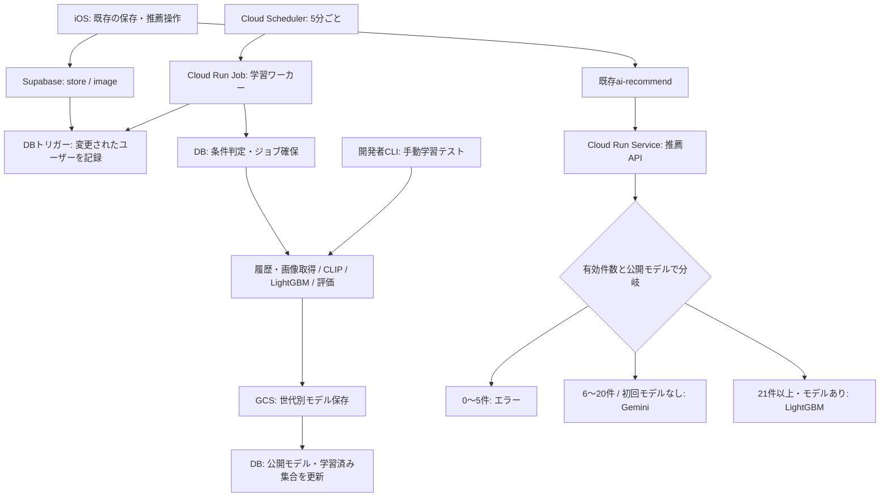

# 推薦方式の切り替えとGCP自動学習の実装プラン

作成日: 2026-10-25（日本時間）

この文書は実装予定を定義するものです。記載する新規ファイル・CLI・設定はまだ実装していません。現行処理は [README.md](README.md) を参照してください。

## 目標と確定仕様

- 推薦リクエストから学習を分離する。
- GCP上でアプリの起動状態に依存せず自動学習する。
- 開発者がローカルとGCPで手動学習テストを実行できるようにする。アプリには操作を追加しない。
- iOSのコード・画面・HTTP応答の既存フィールドとの互換性を維持する。

| 有効な店舗記録数 | 推薦方式 |
|---|---|
| 0〜5件 | 推薦しない。既存のエラー表示で案内できるHTTP 400と `error` を返す |
| 6〜20件 | Geminiによる簡易推薦。保存モデルがあっても、この件数範囲では使わない |
| 21件以上、利用可能モデルあり | 本人のLightGBMによる推薦 |
| 21件以上、初回モデルなし・初回学習中・初回学習失敗 | Geminiで推薦を継続し、学習は独立して再試行 |
| 21件以上、再学習中・再学習失敗 | 前回成功したLightGBMモデルで推薦 |

学習開始は有効記録20件以上、次回以降は前回成功した学習に含まれない有効な店舗が5件以上になった時点とする。通常は20・25・30件だが、22件で初回学習した場合は次回27件。再学習には追加分だけでなく、その時点の全有効記録を使用する。

20件で先にモデルを作り、推薦方式は21件から切り替える。モデルの準備が推薦方式の切り替えに間に合わない場合はGeminiを使う。

## 件数とデータの定義

- 本人の `store.id` を1件とする。同じ記録への再訪問・写真追加を新規店舗として数えない。フレンドの記録は対象外。
- 有効記録は、本人の評価が1〜5、許可されたカテゴリがあり、代表写真を利用できる記録とする。既存の補完可能なNULLは共通の補完ルールで扱う。
- 代表写真は `image.created_at` 昇順・`image.id` 昇順の先頭とし、学習と推薦で一致させる。
- 画像メタ情報の存在だけではダウンロード成功を保証できない。構造上の対象件数と、画像検証後の実際の有効件数を区別する。
- 画像取得の一時障害は店舗が削除されたこととして扱わず、再試行する。破損画像などで対象から除外した場合は理由と件数を記録し、推薦の境界にも検証後の件数を使う。
- 画像検証のキャッシュには画像ID・更新版を使い、新規・変更画像だけを再確認する。Gemini簡易推薦ではCLIP埋め込みは計算しない。
- 学習開始時に店舗ID、代表画像ID、学習に使う値の版を確定する。学習中に追加された店舗は成功時の学習済み集合に含めない。
- 評価・カテゴリ・代表写真の編集は新規追加5件には数えず、次回の学習で反映する。削除も追加数には数えない。画像と評価の取り扱いを含む即時再学習は初期実装の対象外。
- 現在件数から前回件数を引くだけの判定にはしない。削除と追加が重なっても、前回成功した学習の店舗ID集合にない有効店舗を数える。

## 全体構成



既存のCloud Run Serviceは推薦用とし、学習は同じコード・コンテナイメージを使う別のCloud Run Jobで実行する。Jobから `train_user()` 相当の共通関数を直接呼び、長いHTTP通信を経由しない。

Cloud SchedulerからCloud Run Jobを定期実行する方法はGCP公式で提供されている。[公式手順](https://docs.cloud.google.com/run/docs/execute/jobs-on-schedule)

最初は5分間隔の定期確認とする。「5件追加直後に同期実行」ではなく「5件追加を検知して、次の定期実行で学習」という意味での自動化とする。スケジュール遅延、待ち行列、処理時間があるため、5分以内の完了保証ではない。

DBトリガーはネットワーク通信や学習を行わず、店舗・画像の変更を軽く記録するだけにする。店舗が先に保存され写真が後から保存される現行アプリにも対応する。

## 1. DBの変更

新規マイグレーションで次を追加・拡張する。

| 対象 | 用途 |
|---|---|
| `ai_training_dirty_users`（新規） | 対象ユーザー、変更版、最終変更日時。定期処理の全ユーザー走査を避ける |
| `ai_training_jobs`（新規） | ジョブID、ユーザーID、待機・実行中・成功・失敗、試行回数、再試行時刻、リース期限、エラー概要 |
| 学習対象スナップショット（新規） | ジョブが使用した店舗ID・画像ID・データ版。削除後も成功時点の対象を識別できる形で保持 |
| `ai_model_status`（拡張） | 既存の件数・MAEを維持し、公開モデル世代、学習ポリシー版、成功ジョブIDなどを追加 |
| サーバー用DB関数（新規） | 原子的なジョブ取得、実行期限更新、成功確定、失敗・再試行登録 |

実行制御と公開モデル情報の更新はサーバー専用にし、現行の本人による `ai_model_status` 書き込み許可を見直す。既存iOSからのSELECTは維持する。運用エラー詳細や学習対象の内部情報は、アプリ向けの行に格納しない。

トリガーは `store` と `image` のINSERT・UPDATE・DELETEを対象とし、対象ユーザーをdirtyにする。削除イベントのユーザー特定と、同一トランザクション内の重複通知を考慮する。

ユーザー単位で待機・実行中ジョブを集約する。複数Job実行が重なっても、DBの原子的な取得と実行期限付きロックで同じユーザーの重複学習を防ぐ。

## 2. 学習処理の分離

`ml.py` の学習可能な最低件数を20件に変更する。推薦可能件数とは別の定数にし、5件・20件・21件の条件を混在させない。

処理を次に分ける。

1. 共通の履歴取得・補完・画像検証。
2. 学習対象の確定と特徴量作成。
3. LightGBM学習・現行の最大15件の交差検証・MAE算出。
4. モデルの保存。
5. 公開モデルと学習済み集合の更新。

`storage.py` の保存先を `models/{user_id}/{model_version}/model.joblib` に変更し、同じファイルを上書きしない。推薦はDBの公開モデル世代を参照して読み込む。

保存成功後、現在のジョブがまだ有効な実行権を持つことを確認したDBトランザクションで公開する。期限切れの旧ワーカーが新しいモデルを上書き公開しないよう、ジョブID・実行トークンを照合する。失敗時は公開モデル・MAE・学習済み集合を進めない。

画像欠落により有効件数が20件未満なら初回モデルを公開しない。追加有効件数が5件未満なら自動再学習を進めず、データ修復または追加を待つ。

## 3. 自動学習ワーカー

新規 `training_worker.py` をCloud Run Jobの入口とする。

- dirtyユーザーと再試行対象を取得し、初回20件／追加5件の条件を判定する。
- ジョブを確保し、最新の有効履歴で学習する。処理中はリースを更新する。
- 1ユーザーの失敗で他ユーザーの処理を止めない。ユーザー単位で試行回数・次回実行時刻を記録し、回数に上限を設ける。
- Jobの実行ごとに処理人数・時間の上限を設け、未処理対象は次回へ残す。
- dirtyの変更版を学習開始時に記録する。学習中に新しい変更が入った場合、その通知まで消さない。
- 完了後、追加5件に達していないか再確認し、必要なら次の学習を予約する。
- プロセス異常終了時は実行期限切れを検出して再取得する。リトライしても同じ学習対象のモデルが重複公開されないようにする。

定期実行と別に、既存ユーザーをdirtyとして登録する初期化コマンドも用意する。導入前から20件以上あるユーザーも、次の実行で学習対象になる。

## 4. 推薦APIとGemini簡易推薦

`api.py` の `/recommend` から `train_user()` 呼び出しを削除する。モデルがない場合も、推薦リクエスト内で学習しない。

`recommend.py` には、Places検索と写真取得を分けた候補取得、Geminiによる候補の選択・推定評価を追加する。

- 自由文から検索条件を抽出し、Placesから実店舗を取得する流れを維持する。
- Geminiには希望、本人のカテゴリ別評価などの要約、候補の店舗情報を渡す。履歴画像は渡さない。
- 候補IDから最大3件を選択し、1〜5の `predicted_rating` を返す。
- 戻り値のIDが候補内にあるか、重複がないか、評価値が範囲内かをサーバー側で検証する。
- 店名・カテゴリは候補データから再構築し、生成された店名を採用しない。
- Gemini方式では候補写真のCLIP処理やLightGBM呼び出しを行わない。検索と写真ダウンロードを分離し、不要な画像取得も避ける。
- Geminiのエラーは既存の `error` 形式に変換する。利用者向けに未加工の外部APIエラーを返さない。

`predictions` の既存フィールドを維持する。Geminiの推定評価は実際の交差検証結果ではないため、MAEや読み当て率を捏造しない。`ai_model_status` は学習ワーカーだけが実測した学習結果で更新する。

`supabase/functions/ai-recommend/index.ts` は0〜5件を拒否し、6件以上をバックエンドへ渡す。学習結果のupsertは削除する。公開モデル情報はユーザー入力を信用せず、認証済みユーザーに対応するサーバー側の状態から決定する。

21件以上でモデル破損・消失が発生した場合は障害を記録して修復用学習を予約し、当該リクエストはGeminiへ退避する。再試行不能な外部障害や両方式の失敗はエラーとして返す。

## 5. 開発者向けの手動学習テスト

新規 `train_cli.py` を自動学習と同じ学習関数の入口にする。以下は実装予定のインターフェースであり、現時点では実行できない。

```bash
# ローカルのデモ／検証JSONで学習。DBや本番モデルは更新しない
python train_cli.py --records data/train.json --user-id demo_user_0 --output-dir artifacts/manual

# 実ユーザーの自動学習条件だけを確認。学習・公開はしない
python train_cli.py --source supabase --user-id <UUID> --dry-run

# 20件以上の実データで手動テスト。通常の追加5件条件を省略するが、本番公開はしない
python train_cli.py --source supabase --user-id <UUID> --force --output-dir artifacts/manual
```

- `--force` は追加5件の待ち条件を省略するもので、最低20件・入力検証・同時実行制御は省略しない。
- 既定は検証用保存先への出力とし、本番の公開モデル、学習済み集合、アプリが読む統計を変更しない。
- 本番へ反映する運用は、別の明示的な `--publish` 指定とサーバー権限を必要とする。通常の世代管理・公開手順を通す。
- 件数、CLIP処理時間、学習・評価時間、MAE、ファイル容量、出力先を表示する。認証情報や画像Base64をログに出さない。
- GCP上でも同じCLIを実行する手動検証用Cloud Run Jobを用意し、自動学習と同じコンテナを使う。出力先は検証用GCSプレフィックスに分ける。
- 実データ取得の認証情報はサーバー／開発環境にのみ置く。アプリに手動学習のAPIやボタンは追加しない。

## 6. GCPの設定とデプロイ成果物

| 項目 | 予定 |
|---|---|
| Cloud Run Service | 既存推薦APIを更新。学習を推薦経路から分離 |
| Cloud Run Job（自動） | `training_worker.py` を実行。最初は1タスク、処理人数と実行時間を制限 |
| Cloud Run Job（手動検証） | `train_cli.py` を実行。本番公開を既定で無効にする |
| Cloud Scheduler | 5分ごとに自動Jobを起動 |
| GCS | 世代別の本番モデルと検証出力を分離 |
| Secret Manager | Supabaseのサーバー用認証情報、既存共有キーなどを管理 |
| Cloud Logging | ジョブID、学習件数、方式、所要時間、失敗・再試行、公開世代を記録 |

Schedulerの呼び出し用サービスアカウントと、学習Jobの実行用サービスアカウントを分ける。Schedulerには対象Jobの実行権限を与え、学習Jobには必要なSecret参照・モデル保存権限を与える。実データ取得にはサーバー用のSupabase認証を使う。

SchedulerからJob起動APIへの認証は公式手順に従ってOAuthを設定する。通常のCloud RunサービスURLへのOIDC認証と取り違えない。[Cloud Run Jobのスケジュール実行](https://docs.cloud.google.com/run/docs/execute/jobs-on-schedule)

構成・デプロイ・手動実行・停止・ロールバックの再現可能なスクリプトを追加する。CPU・メモリ・タイムアウトはまず実測し、CLIP起動と最大想定履歴で決める。学習Jobの成功終了だけでなく、ユーザー単位の失敗・再試行上限到達・古い実行中ジョブも監視対象とする。

## 7. 実装順序

| 段階 | 主な変更 | 完了条件 |
|---|---|---|
| 1 | 境界条件・共通履歴処理・代表写真選択の整理 | 0〜5／6〜20／21以上、学習開始20件が独立してテスト可能 |
| 2 | DBマイグレーション、ジョブ取得・公開処理 | 重複学習と期限切れワーカーの公開を防げる |
| 3 | 学習関数分離、世代別保存、手動CLI | ローカル実データ形式と人工データで非公開の学習テストができる |
| 4 | 学習ワーカー、再試行、初期化 | Jobの1回実行で条件判定から学習・公開まで完結 |
| 5 | Gemini簡易推薦、推薦経路の学習削除、Edge Function変更 | iOSを変えずに全件数条件で応答できる |
| 6 | GCPデプロイ、Scheduler、自動・手動Jobの運用手順 | アプリを閉じても自動学習され、手動検証は本番モデルを変更しない |
| 7 | README・REQUIREMENTS更新、実測値記録 | 現行実装と文書の矛盾を解消 |

## 8. 検証項目

- 推薦境界: 0・5・6・19・20・21件。20件でモデルがあってもGemini、21件以上で有効モデルがあればLightGBM。
- 自動学習: 19→20件、初回22件、追加4→5件、学習中の追加、削除後の追加、同じ店舗への再訪問。
- データ準備: 店舗保存後の写真追加、画像アップロード再試行、同じ店舗への複数画像、破損画像、一時的ダウンロード失敗。
- 並行処理: Schedulerの重複起動、同一ユーザーのジョブ競合、リース失効と旧ワーカー復帰、保存後・公開前の異常終了。
- 失敗処理: GCS障害、学習失敗、ジョブ再試行、初回失敗時のGemini退避、再学習失敗時の旧モデル維持。
- Gemini: 不明な店舗ID、重複、範囲外評価、不正JSON、候補0件、外部APIエラー。
- 互換性: 既存iOSが成功応答・エラーを読み取れること。5件では現行ボタンが表示されるが、押すとあと1件の案内を既存エラー表示で返す。
- 手動テスト: 既定では公開モデル・学習済み集合・アプリ統計を変えないこと。明示的な公開時は通常の排他制御を通ること。
- 認証: 他ユーザーの学習起動・ジョブ改変・モデル世代の指定を拒否すること。
- 実環境: ステージングでScheduler起動→学習→世代公開→21件以上の推薦切り替えまで確認する。

## 9. 導入と切り戻し

1. 旧処理と共存できる追加マイグレーションを先に適用する。
2. 手動検証Jobで学習時間・保存容量・実データの有効件数を確認する。
3. 世代指定モデル読み込みに対応した推薦API、学習Jobを用意する。
4. 既存ユーザーをdirty登録し、新ポリシーで学習する。旧5件学習モデルは新ポリシー適合モデルとして扱わない。
5. 推薦APIとEdge Functionの切り替えを整合する順で行い、応答互換性を確認する。APIは移行中の旧Edgeリクエスト形式も受け付ける。
6. Schedulerを有効化して実行履歴・再試行・Gemini退避率を確認する。

障害時はSchedulerを停止し、公開モデルの参照を直前の正常世代に戻す。モデル未準備・利用不可のユーザーにはGeminiを使用し、0〜5件の制限は維持する。切り戻しで同期学習を推薦経路に復活させないよう、学習分離後の安定リビジョンを残す。

## 対象外

iOSの画面変更、即時WebhookによるGCP起動、フレンドを混ぜた学習、CLIPの追加学習、履歴埋め込みの永続キャッシュによる全面的な高速化は、この実装の必須範囲に含めない。自動学習の間隔短縮と高速化は、動作と実測値を確認した後に扱う。
