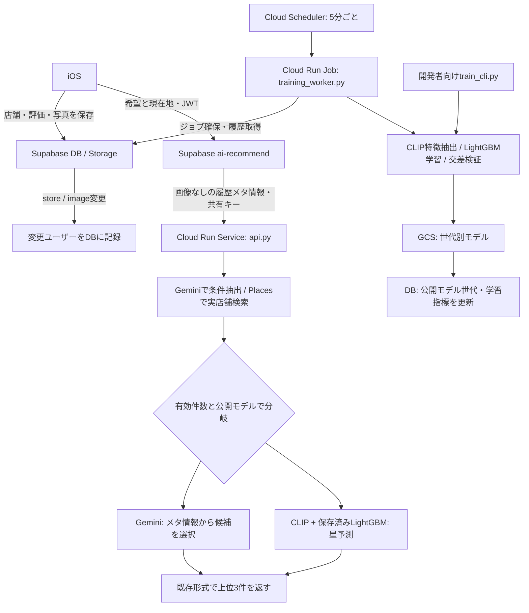

# MoguMap AIバックエンド

料理写真と本人の星評価からユーザー別LightGBMモデルを作り、Gemini・Google Placesと組み合わせて実店舗を推薦します。学習は推薦リクエストから分離し、Cloud Run Jobで自動／手動実行します。

## 推薦と学習の条件

| 評価・代表写真のメタ情報がある本人の店舗記録数 | 推薦 |
|---|---|
| 0〜5件 | Geminiの簡易推薦 |
| 6件以上・公開済みモデルあり | LightGBMで本人の星評価を予測 |
| 6件以上・初回学習前／初回学習中／モデル利用不可 | Geminiを継続。モデル障害時は修復学習を予約 |

初回学習は6件から。その後は、最後に成功した学習に含まれない有効店舗が5件以上追加されるごとに、全履歴で再学習します。通常は6・11・16件ですが、初回が8件なら次回13件です。削除との相殺で追加を見落とさないよう、学習済み店舗ID集合で判定します。同じ店舗への再訪問や写真追加は追加店舗数に数えません。再学習中・失敗時は前回成功したモデルを使用します。

iOSの育成タブは登録0件から推薦入力を出すため、0〜5件のGemini推薦はアプリからそのまま使えます。学習操作はアプリには追加しません。

## データの流れ



Edge FunctionはユーザーJWTを検証し、本人の `store` と関連する `image` のメタ情報を取得します。代表写真のID・本人の評価・店舗情報・解析済みの料理特徴だけをCloud Runへ送り、写真のダウンロード・Base64化・画像バイナリの送信は行いません。バックエンドはSupabaseへ登録された公開モデル世代を自分で確認し、アプリからモデル世代を指定させません。Cloud Run APIは `X-API-Key` 認証と、インスタンス単位のレート制限（既定20回／分）を使用します。

バックエンドはまず履歴のメタ情報を検証します。0〜5件、または公開済みモデルがない場合は、Storageにも画像検証にもアクセスせずGeminiへ進みます。LightGBMを使う場合だけ、バックエンドが本人の履歴・写真をSupabaseから取得して画像を検証し、CLIPへ入力します。実際に利用できる画像が6件未満の場合や、画像取得・モデル利用に失敗した場合はGeminiへ切り替えます。

## iOSアプリからの呼び出し

[GrowViewModel.swift](../GourmetShareMap/Features/Grow/ViewModels/GrowViewModel.swift) が現在地を取得し、[LiveRecommendService.swift](../GourmetShareMap/Features/Grow/Services/LiveRecommendService.swift) から次のリクエストを送ります。リクエストのタイムアウトは120秒です。

```http
POST <SUPABASE_URL>/functions/v1/ai-recommend
Authorization: Bearer <Supabaseアクセストークン>
Content-Type: application/json

{"free_text":"静かな和食を食べたい","lat":35.6812,"lng":139.7671}
```

アプリは `user_id`・履歴・モデルを送信しません。Edge Functionが認証済みユーザーのDBとStorageから履歴を組み立て、`X-API-Key` を付けてCloud Runの `/recommend` へ渡します。モデルの選択には、バックエンドで画像・評価を検証した有効件数を使うため、画面の登録件数と異なる場合があります。

推薦結果は `predictions` の店舗ID・店名・カテゴリ・予測評価から表示し、店舗IDを使ってGoogle Mapsを開きます。学習状態は `ai_model_status` の `record_count`・`mean_abs_error` を別途読み込みます。状態取得は画面表示時や記録変更時に行い、自動学習の完了直後に画面を更新する処理はありません。

## 使用モデルと学習方法

| 要素 | モデル・処理 | 学習 |
|---|---|---|
| 写真の特徴抽出 | `sentence-transformers/clip-ViT-B-32`、正規化512次元画像埋め込み | 共有・凍結。追加学習なし |
| 個人の好み予測 | LightGBM `LGBMRegressor` | 本人の1〜5の評価を教師にユーザー別で学習 |
| 条件抽出・簡易推薦 | Vertex AI Gemini `gemini-3.5-flash-lite`（`GEMINI_MODEL` で指定） | 追加学習なし。自由文・カテゴリ別評価の要約・直近の料理の特徴・候補情報から推論 |
| 実店舗検索 | Google Places API (New) Text Search | モデル学習なし |

推薦用モデルの既定値は `gemini-3.5-flash-lite` です。[モデル仕様](https://docs.cloud.google.com/gemini-enterprise-agent-platform/models/gemini/3-5-flash-lite)。環境変数 `GEMINI_MODEL` が設定されている場合は、その値を使用します。

Geminiは実店舗検索の条件をJSONで抽出し、簡易推薦では検索結果の候補IDと推定評価だけを返します。サーバーが候補ID・重複・評価範囲を検証し、店名はPlacesの結果から復元します。Geminiへの履歴画像送信は行いません。代わりに簡易推薦では、`image.dish_features`（[analyze-dish](../supabase/DISH_ANALYSIS.md) の解析結果、`dish_features_status = 'done'` の写真のみ）の `features` を、新しい順に最大10店ぶん（各店の解析済み写真すべて）、その店の評価・カテゴリと組にして `rated_dishes` として渡します。簡易推薦ではCLIPも候補写真のダウンロードも行いません。

Places検索は現在地を中心とする3,000mの `locationBias` を使用します。厳密な距離制限ではありません。候補は最大10件、返却は最大3件です。カテゴリは抽出したカテゴリを候補に共通で設定し、既訪問店舗の除外はしません。

### LightGBMの入力（通常533次元）

| 特徴量 | 次元 | 内容 |
|---|---:|---|
| 店舗情報 | 3 | Google公開評価、`log(1 + review_count)`、価格帯 |
| カテゴリ | 13 | アプリと共通の13分類のone-hot |
| 本人の履歴 | 5 | 履歴件数、全体平均評価、同カテゴリ平均評価、好き／苦手な写真との類似度 |
| 写真 | 512 | 正規化されたCLIPベクトル |

カテゴリ: 和食／ラーメン・麺類／焼肉・肉料理／中華／カレー／アジア・エスニック／洋食・西洋料理／ファストフード・食堂／カフェ・喫茶／パン／スイーツ／居酒屋・バー／その他。

好きは評価4以上、苦手は2以下の画像を平均し、再正規化したベクトルとのコサイン類似度で表します。本人の評価 `rating` が目的変数で、Google公開評価 `google_rating` は入力です。他ユーザーの履歴は学習しません。

履歴を `rated_at` 順に並べ、各学習行の履歴特徴量はそれより前の記録だけで作ります。現在のアプリ連携では `store.created_at` を `rated_at` とします。日時文字列は時系列順に並ぶ形式へ揃えて入力してください。

LightGBMは決定木を順次追加して誤差を補正する回帰です。履歴件数 `N` に対して次の設定を使います。

```text
n_estimators = min(150, max(20, N * 6))
learning_rate = 0.1
num_leaves = max(2, min(15, N))
max_depth = 4
min_child_samples = 1
min_split_gain = 0
random_state = 42
n_jobs = 1
```

評価は1件抜き交差検証のMAE（平均絶対誤差）です。15件を超える場合は評価対象だけ直近15件に絞り、学習には除外対象以外の全履歴を使います。対象日時より後の記録も学習側に入り得るため、厳密な将来予測の時系列評価ではありません。予測値は1〜5に収め、小数第2位に丸めて降順に返します。

iOSの「好みの読み当て」は `round(max(0, 1 - MAE / 4) * 100)` で換算する表示であり、推薦成功確率ではありません。Gemini推薦では架空のMAEを保存しません。

## 履歴とモデルの保存

- 代表写真は `image.created_at` 昇順、同日時は `image.id` 昇順の先頭1枚です。学習と推薦で揃えています。
- 推薦のメタ情報は本人の評価・カテゴリ・数値範囲を検証し、店舗IDの重複を除外します。学習・ML推論ではさらに画像を検証し、最大5 MiBを超える画像や読み込めない画像を除外します。学習時の一時的なStorage通信障害はジョブの再試行対象とし、推薦時の画像取得障害はGeminiへの切り替え対象とします。
- 欠損する店舗情報は価格帯2、公開評価3.5、レビュー数50、カテゴリ「その他」で補完します。Places候補のレビュー数既定値は0です。
- 学習対象は最大2,000件。DB履歴はページ取得し、画像取得は最大8並列です。
- 画像の検証結果は内容ハッシュでプロセス内にキャッシュします。CLIP埋め込みの永続キャッシュはありません。
- モデル実体は `gs://<MODEL_BUCKET>/models/{user_id}/{model_version}/model.joblib`。未設定時は `artifacts/models/...`。最終モデル・特徴列名・CLIP ID・学習ポリシー版を保存します。
- `ai_model_status` は最終成功モデルの公開先・件数・MAE・学習済み店舗IDを保持します。失敗時は変更しません。
- DBの実行期限付きロック・ジョブIDによる公開チェックで、古いワーカーの公開を防ぎます。学習中の新しいデータ変更も残します。
- 再試行はユーザーごとに最大5試行。待機時間は指数的に増やします。新しいデータ変更または `--seed-user` で再び処理対象にできます。長時間実行では30秒ごとに5分のリースを更新します。
- 評価・画像の編集は追加5件に数えず、次回学習で反映します。モデルファイルの旧世代は自動削除しません。

## ローカル実行と手動学習

リポジトリルートから実行します。Python 3.12を想定します。

```bash
python3 -m venv mogumap_clip_lgbm/venv
mogumap_clip_lgbm/venv/bin/python -m pip install -r mogumap_clip_lgbm/requirements.txt
mogumap_clip_lgbm/venv/bin/python mogumap_clip_lgbm/generate_demo.py
mogumap_clip_lgbm/venv/bin/python mogumap_clip_lgbm/train_cli.py \
  --records mogumap_clip_lgbm/data/train.json --user-id demo_user_0
```

`generate_demo.py` は既存のデモデータを再生成するため、保持したいデモファイルがある場合は先に退避してください。デモデータには上記13分類のカテゴリを使用します。初回CLIP実行では重み取得が必要です。Linuxでは `libgomp1` などのOpenMPランタイムも必要です。

ルートから `from ml import ...` を実行すると別パッケージを読むことがあるため、上記のようにスクリプトのパスを指定してください。`ModuleNotFoundError: joblib` などの場合は同じPythonで `-m pip install -r ...` を実行します。

実ユーザーの履歴を取得する場合は `SUPABASE_URL` と `SUPABASE_SERVICE_ROLE_KEY` をサーバー側環境に設定します。

```bash
# 読み取りと条件確認だけ。学習もDB更新もしない
mogumap_clip_lgbm/venv/bin/python mogumap_clip_lgbm/train_cli.py \
  --source supabase --user-id <UUID> --dry-run

# 新規5件の条件を省略してテスト。最低6件は必須。本番モデル・統計を更新しない
mogumap_clip_lgbm/venv/bin/python mogumap_clip_lgbm/train_cli.py \
  --source supabase --user-id <UUID> --force

# 明示的に本番モデルを公開する運用。自動学習と同じDB排他・公開手順を使う
mogumap_clip_lgbm/venv/bin/python mogumap_clip_lgbm/train_cli.py \
  --source supabase --user-id <UUID> --force --publish
```

既定の手動出力先はこのディレクトリの `artifacts/manual/`。`--gcs-test` を付けるとGCSの `manual-tests/` 以下に保存し、DB・本番モデルは更新しません。CLIは学習件数、CLIP時間、学習・評価時間、全体時間、MAE、ファイル容量、保存先を表示します。

APIのローカル起動:

```bash
export AI_BACKEND_API_KEY='dev-only-change-me'
mogumap_clip_lgbm/venv/bin/python -m uvicorn api:app \
  --app-dir mogumap_clip_lgbm --host 127.0.0.1 --port 8000
```

### API

| パス | 内容 |
|---|---|
| `GET /health` | 死活監視。外部サービスやモデルは確認しない |
| `POST /recommend` | `user_id`, `free_text`, `lat`, `lng`, `history`。学習しない |
| `POST /train` | 開発者向け。`user_id`, `records`（最低6件）。世代別保存するがDBへ公開しない |
| `POST /predict` | 開発者向け。`user_id`, `model_version`, `history`, `candidates`。既存モデルで推論 |

`/health` 以外は `X-API-Key` が必須です。バックエンドはユーザーJWTを直接検証しないため、ユーザー向けアクセスは認証済みEdge Function経由にします。

`/recommend` の `history` は画像なしの履歴メタ情報を受け付けます。各行は `user_id`, `place_id`, `image_id`, `category`, `rating`, `rated_at` と、価格帯・公開評価・レビュー件数・任意の `dish_features` を持ちます。入力に `image_base64` や `image_path` があってもGeminiへは渡しません。

`/train`・`/predict` の学習・推論用履歴の必須情報は `user_id`, `place_id`, `image_id`, `category`, `price_level`, `google_rating`, `review_count`, `rating`, `rated_at` と `image_base64` または `image_path`。画像パスはこのディレクトリを基準とし、Base64があれば優先します。候補には本人の評価・ユーザーID・日時は不要です。

`/recommend` の応答例:

```json
{
  "predictions": [{"place_id":"real-place-id","name":"サンプル食堂","category":"和食","predicted_rating":4.2}],
  "conditions": {"category":"和食","keywords":[],"search_query":"和食"},
  "mode": "gemini"
}
```

`mode` は `gemini` または `lightgbm`。iOSは `predictions` を読み取り、`mode` は表示に使用しません。Edge FunctionはFastAPIのエラーを `{"error":"..."}` 形式に変換します。

## GCPでの自動実行

Cloud SchedulerからCloud Run Jobを起動します。[GCP公式手順](https://docs.cloud.google.com/run/docs/execute/jobs-on-schedule)に従い、Job起動APIにはOAuth認証を使います。推薦用Cloud Run Serviceへのユーザー操作とは独立です。

1. `supabase/migrations/20261025120000_ai_background_training.sql` を適用する。store/imageトリガー・ジョブ・公開処理を追加し、既存ユーザーも初回確認対象に登録します。
2. 既存GCPプロジェクトにログインし、下記環境変数を設定する。
3. Secret Managerに既存共有キー・Placesキー・Supabaseサーバーキーを用意する。値をスクリプトに直書きしない。
4. `setup_gcp.sh`、`deploy_gcp.sh` を実行する。
5. `supabase functions deploy ai-recommend` でEdge Functionを更新する。
6. 手動Jobで条件確認・学習テスト後、自動Jobを1回実行しDBの公開世代と推薦方式を確認する。
7. `enable_schedule.sh` で5分ごとの自動起動を有効にする。

```bash
export PROJECT_ID='<既存GCPプロジェクト>'
export REGION='asia-northeast1'
export MODEL_BUCKET='<既存モデルバケット名>'
export SUPABASE_URL='https://<project>.supabase.co'
export API_SERVICE='<既存Cloud Runサービス名>'
export IMAGE_TAG='<一意のリリースタグ>'
export GEMINI_MODEL='gemini-3.5-flash-lite'

bash mogumap_clip_lgbm/deploy/setup_gcp.sh
bash mogumap_clip_lgbm/deploy/deploy_gcp.sh

export TRAIN_USER_ID='<テスト対象ユーザーUUID>'
bash mogumap_clip_lgbm/deploy/run_manual.sh --dry-run
bash mogumap_clip_lgbm/deploy/run_manual.sh --test
gcloud run jobs execute mogumap-train --region="$REGION" --project="$PROJECT_ID" --wait
bash mogumap_clip_lgbm/deploy/enable_schedule.sh
```

スクリプトの既定Secret名は `supabase-service-role-key`、`ai-backend-api-key`、`places-api-key`。既存名に合わせて `SUPABASE_KEY_SECRET`・`AI_KEY_SECRET`・`PLACES_KEY_SECRET` を上書きできます。Job名などの上書き変数は各スクリプト冒頭を参照してください。

学習Jobは初期値2 CPU・4 GiB、1タスク、最大10ユーザー、次のユーザーへ進む時間予算600秒、タスク全体上限1,800秒です。1ユーザーの学習が時間予算を超える場合もタスク上限までは処理します。実データ量に合わせて調整してください。スケジュールはデプロイ時に停止状態にし、検証後に明示的に再開します。

`ai_training_jobs` の `state`・`error_code`、`ai_training_dirty_users` の `attempts`・`lease_until` を運用で確認してください。最大5試行に達したユーザー、古いリース、Geminiへの退避、学習が長時間成功していないユーザーを監視対象にします。例外ログにはキーや画像を含めず、エラーの型を記録します。

再試行対象の再登録は `training_worker.py --seed-user <UUID>`。切り戻し時はSchedulerをpauseし、正常な前世代モデルの `ai_model_status`（モデル世代・パス・学習済み集合・件数・MAEを一組で）をサーバー権限で復元します。APIの切り戻しには、ジョブ管理と公開モデルの参照に対応する安定リビジョンを使ってください。

### 環境変数

| 変数 | 用途 |
|---|---|
| `AI_BACKEND_API_KEY` | Edge→推薦APIの共有キー |
| `SUPABASE_URL`, `SUPABASE_SERVICE_ROLE_KEY` | APIの公開モデル確認、Job／CLIのデータ取得・ジョブ操作。サーバーのみ |
| `MODEL_BUCKET` | GCSバケット名。未設定ならローカル保存 |
| `CLIP_DEVICE` | 既定 `cpu` |
| `GOOGLE_CLOUD_PROJECT` | Vertex AIのプロジェクト |
| `VERTEX_LOCATION`, `GEMINI_MODEL` | 既定 `global`, `gemini-3.5-flash-lite`。利用可能なモデルに合わせて変更 |
| `PLACES_API_KEY` | Places API (New) |
| `RATE_LIMIT_PER_MINUTE` | インスタンス単位のAPI制限。既定20 |
| `TRAIN_USER_ID` | 手動検証JobでCLI引数の代わりに使うユーザーUUID |

GCPではサービスアカウントのADCを使用します。DockerfileはCLIPをビルド時に取得し、実行時は `HF_HUB_OFFLINE=1`・`TRANSFORMERS_OFFLINE=1` でネットワーク確認を避けます。

## 処理時間とファイル容量

**実測例と概算を分けて記載します。** ローカルでの測定例では、人工データ6件・CPU・`OMP_NUM_THREADS=2`・CLIP初回ロードを含め、CLIP処理11.734秒、特徴量作成＋学習＋交差検証0.225秒、全体11.965秒、保存ファイル59,272 bytesでした。CLIP重みはローカルキャッシュを使用し、GCSやGemini等の通信は含みません。単回の動作確認であり、Cloud Runの性能保証や実画像での推薦品質評価ではありません。

性能設計前の仮置きとして、ウォームCPUで画像1枚のCLIP処理を50〜300ms、LightGBMの1店舗予測を1〜10ms程度とすると、写真からの推論計算は1店舗約0.05〜0.3秒が目安です。これらの値は推論の実測値ではありません。モデル取得・履歴特徴量作成・通信・コールドスタートは別途かかります。

現在のML推論は候補だけでなく履歴画像も再計算します。履歴 `N`、候補 `K`、画像特徴抽出 `E` とすると、概ね `T_predict = モデル取得 + E(N+K) + 特徴量作成 + LightGBM予測`。例えば履歴30件＋候補10件は40枚が対象です。Gemini経路はCLIP処理を行いません。

学習は `E(N)` に加え、最終学習1回と交差検証最大15回。学習のたびに全履歴を使用するため、追加5件だけでなく全履歴のサイズが処理時間を決めます。モデルは最大150本・各15葉以下の決定木とメタ情報で、ユーザー別容量予算として数十KiB〜1MiBを仮置きできます。CLIP本体・画像・旧世代は含めません。CLIの `model_size_bytes` と各時間で実データの計測を更新してください。

### 推薦の処理時間ログ

推薦APIは `recommend mode=... total=... stages=...` を記録します。`stages` は `metadata`（メタ情報検証）、`model_status`、`conditions`（Gemini条件抽出）、`places`、`gemini_rank`（Gemini推薦）です。ML経路ではさらに `model_load`、`history_images`、`ml` を記録します。実行しなかった段階は含まれません。`total` はメタ情報検証から応答生成までで、iOSの現在地取得、Edge FunctionのDB取得、Cloud Runの起動待ちは含みません。

## テスト

```bash
cd mogumap_clip_lgbm
venv/bin/python -m pip install -r requirements-dev.txt
venv/bin/python -m unittest discover -s tests -v
cd ..
node --disable-warning=ExperimentalWarning supabase/tests/ai_recommend_test.mjs
bash supabase/tests/check_ai_training_db.sh
```

Pythonテストは外部APIをモックし、実際のLightGBM学習・シリアライズも検証します。DBテストは一時PostgreSQLコンテナで、マイグレーション、画像後着、排他、期限切れ、公開・失敗・権限を確認し、既存DBへ接続しません。Docker実行権限が必要です。Node 24によるEdge Functionテストも外部通信をモックして実コードを実行します（Denoの型チェックは別途必要です）。

## ファイル構成

| ファイル | 役割 |
|---|---|
| [api.py](api.py) | FastAPI、共有キー認証、レート制限、推薦方式の選択 |
| [policy.py](policy.py) | 件数条件、カテゴリ、学習ポリシー |
| [history.py](history.py) | 履歴の検証・補完、画像検証、学習対象のスナップショット |
| [repository.py](repository.py) | Supabase REST APIによる履歴・画像・状態の取得、ジョブ操作 |
| [recommend.py](recommend.py) | Gemini、Places検索、候補写真の取得 |
| [ml.py](ml.py) | CLIP特徴量、LightGBM学習・評価・推論 |
| [storage.py](storage.py) | GCS／ローカルへの世代別モデル保存 |
| [training_worker.py](training_worker.py) | 自動学習Job、リース更新、失敗処理 |
| [train_cli.py](train_cli.py) | 開発者向けの手動学習・検証・公開 |
| [deploy/](deploy/) | GCP設定・デプロイ・手動Job・スケジュール有効化 |
| [tests/](tests/) | Pythonのテスト |
| [ai-recommend/index.ts](../supabase/functions/ai-recommend/index.ts) | iOSとCloud Runの中継 |
