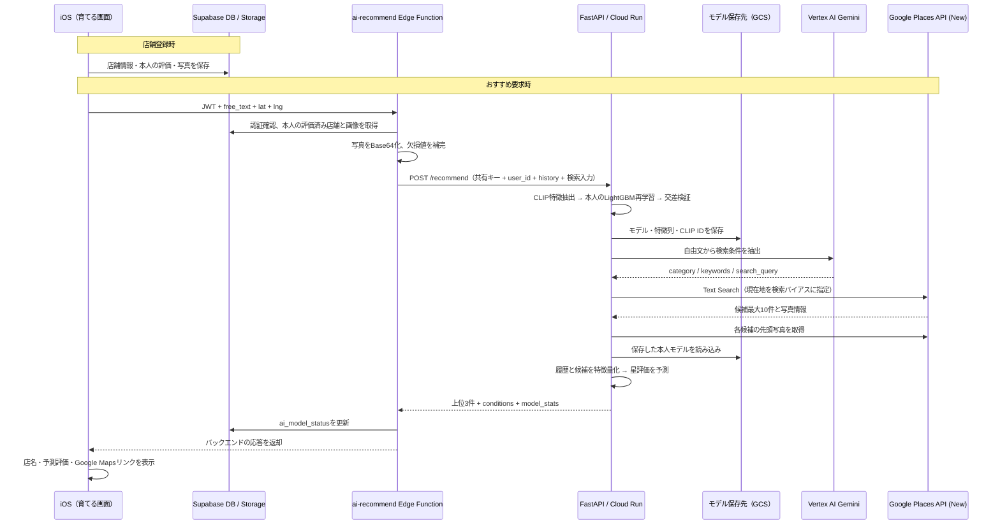

# MoguMap AIバックエンド — CLIP + LightGBM

MoguMap（GourmetShareMap）の「AIを育てる」機能を支えるPythonバックエンドです。本人が登録した店舗の写真・店舗情報・星評価から、**ユーザーごとのLightGBM回帰モデル**を学習し、希望と現在地に合う実店舗を予測評価順に最大3件返します。

このREADMEは、同ディレクトリ直下の現行コードとiOS・Supabase連携の実装を説明します。[REQUIREMENTS.md](REQUIREMENTS.md) は設計時の資料です。そこに記載された「5件追加ごとのWebhook学習」は現行実装にはなく、**おすすめ要求のたびに最新履歴で再学習**します。配下の `mogumap_clip_lgbm/` は旧プロトタイプで、以下の起動手順はこのREADMEと同じ階層のコードを対象にします。

## 全体構成とデータの流れ



店舗登録だけでは学習は走りません。`/recommend` はモデルの有無にかかわらず毎回学習します。`MODEL_BUCKET` 未設定時は、図のGCSの代わりにローカルの `artifacts/` を使います。

## 使用モデルと役割

| 要素 | 使用モデル・方式 | 役割と学習の有無 |
|---|---|---|
| 画像特徴抽出 | `sentence-transformers/clip-ViT-B-32` | 学習済みCLIPの画像エンコーダーを共有・凍結して使用。写真を正規化された512次元ベクトルへ変換し、追加学習はしない |
| 個人の好み予測 | LightGBM `LGBMRegressor` | 本人の1〜5の星評価を教師として、ユーザーごとに別の回帰モデルを学習 |
| 自由文の理解 | Vertex AI Gemini | `category`・`keywords`・`search_query` をJSONで抽出。本人の評価を学習させる処理はない |
| 候補店舗の取得 | Google Places API (New) | Text Searchと写真取得で実在する候補を集める |

Geminiのモデル名は `GEMINI_MODEL` で変更でき、コード上の既定値は `gemini-3.8-flash`、接続先の既定値は `global` です。これはリポジトリの設定値であり、実行先での利用可否は環境に依存します。

Geminiには自由文を含むプロンプトとカテゴリ定義を渡し、履歴の画像や評価は渡しません。画像はバックエンド内のCLIPで処理します。店名はGeminiに生成させず、Placesの検索結果を使用します。

## 学習アルゴリズム

### 入力と教師データ

1件の店舗記録を1学習サンプルとし、本人の `rating`（DBの `store.reputation`）を目的変数にします。Googleの公開評価 `google_rating` は入力特徴量です。他ユーザーやフレンドの履歴は学習に混ぜません。学習開始には、評価と使用可能な画像を持つ記録が最低5件必要です。

入力レコードの例（`/train` の `records`、`/recommend`・`/predict` の `history` に共通）:

```json
{
  "user_id": "demo_user_0",
  "place_id": "store-001",
  "image_id": "image-001",
  "image_path": "data/images/demo_000.png",
  "category": "和食",
  "price_level": 2,
  "google_rating": 4.1,
  "review_count": 120,
  "rating": 5,
  "rated_at": "2026-10-25T12:00:00Z"
}
```

| フィールド | 内容 |
|---|---|
| `user_id` | 学習対象ユーザー。`/train` では全記録がリクエストのユーザーと一致することを検証 |
| `place_id` | 店舗の識別子。履歴ではSupabaseの `store.id`、Places候補ではGoogle Place ID |
| `image_id` | 画像の識別子。同じ埋め込み計算内では、このIDで画像を重複排除 |
| `image_base64` / `image_path` | どちらかが必須。両方ある場合はBase64を優先。相対パスの基準はこのディレクトリ |
| `category` | 下記13分類のいずれか |
| `price_level` | 価格帯。アプリ連携では1〜4の値を使用 |
| `google_rating` | Googleの公開平均評価 |
| `review_count` | Googleのレビュー件数 |
| `rating` | 本人の評価。1〜5の範囲を検証 |
| `rated_at` | 学習時の並び順に使う日時文字列。時系列順に並ぶよう形式・タイムゾーンを揃える |

推論候補は `user_id`・`rating`・`rated_at` が不要で、表示用の `name` を追加できます。Base64画像はData URL形式も受け付け、デコード後5 MiBを超えるとエラーになります。RGBへ変換してCLIPに入力します。

カテゴリはアプリの `PlaceCategoryClassifier` に合わせた次の13種類です。

```text
和食 / ラーメン・麺類 / 焼肉・肉料理 / 中華 / カレー / アジア・エスニック /
洋食・西洋料理 / ファストフード・食堂 / カフェ・喫茶 / パン / スイーツ /
居酒屋・バー / その他
```

### 特徴量（通常533次元）

`ml.py` の `featurize()` が、店舗情報・本人の履歴・画像埋め込みを結合します。

| 特徴量 | 次元 | 計算方法 |
|---|---:|---|
| `google_rating` | 1 | Googleの公開平均評価 |
| `review_count_log` | 1 | `log(1 + review_count)` |
| `price_level` | 1 | 価格帯の数値 |
| `cat_0`〜`cat_12` | 13 | カテゴリのone-hot表現 |
| `hist_count` | 1 | 履歴件数 |
| `hist_avg` | 1 | 本人の過去評価の平均。履歴なしは3.0 |
| `cat_hist_avg` | 1 | 対象と同カテゴリの過去評価平均。該当なしは本人の全体平均 |
| `liked_image_similarity` | 1 | 評価4以上の写真の平均ベクトルを再正規化し、対象写真とのコサイン類似度を算出 |
| `disliked_image_similarity` | 1 | 評価2以下の写真について同様に算出 |
| `clip_000`〜`clip_511` | 512 | 対象写真の正規化済みCLIP画像埋め込み |

好き・苦手に該当する履歴がない場合、類似度は0です。自由文、緯度経度、店名、メモ、訪問回数、ユーザーIDそのものは回帰モデルの特徴量に含めません。

### 学習手順とパラメータ

`train_user()` は次の順で実行します。

1. 最低件数・必須フィールド・カテゴリ・評価範囲・ユーザーの一致を検証。
2. 記録を `rated_at` で昇順に並べ、画像をCLIPで埋め込み化。
3. 各記録について、その記録より前の履歴だけから履歴特徴量を作成。自分自身の正解評価をその行の履歴特徴量に含めない。
4. 全学習行でLightGBMを学習し、別途交差検証のMAEを計算。
5. モデル・特徴列の順序・CLIPモデルIDをまとめて保存。

LightGBMは複数の決定木を順次追加し、予測の誤差を補正する勾配ブースティングによる回帰です。少数データに合わせ、学習件数 `n` に応じて木の数や葉の数を抑えています。

| パラメータ | 設定値 |
|---|---|
| `n_estimators` | `min(150, max(20, n * 6))` |
| `learning_rate` | `0.1` |
| `num_leaves` | `max(2, min(15, n))` |
| `max_depth` | `4` |
| `min_child_samples` | `1` |
| `min_split_gain` | `0.0` |
| `random_state` | `42` |
| `n_jobs` | `1` |

### 評価方法

1件を除外して残りで学習するLOOCV（leave-one-out交差検証）を用い、`mean_abs_error` を返します。記録が15件を超える場合は、評価対象だけを直近15件に絞り、各回の学習には除外した1件以外の全記録を使います。

```text
MAE = mean(abs(予測評価 - 本人の実評価))
```

評価対象の履歴特徴量には、その対象より前の記録だけを使います。ただし各回のモデル学習には対象日時より後の記録も入り得るため、この数値は将来予測を厳密に検証する時系列評価ではありません。データが5件あれば動作しますが、それだけで推薦品質が保証されるわけではありません。

iOSの「好みの読み当て」は `round(max(0, 1 - MAE / 4) * 100)` で表示します。例えばMAEが0.8なら80%です。この値はMAEを表示用に換算したもので、分類の正解率や推薦の成功確率を表す値ではありません。

## 候補生成と推論

`/recommend` の再学習後は、`recommend.py` と `ml.py` が次の処理を行います。

1. Geminiで希望を構造化。例えば「静かな和食を食べたい」からカテゴリと検索クエリを抽出。
2. Places Text Searchを日本語・最大10件で実行。現在地を中心とする半径3,000mの `locationBias` を指定する。これは検索の優先範囲で、範囲内への厳密な制限ではない。
3. 各候補の先頭写真を最大幅400pxで並列取得。写真なし・写真取得失敗の候補は除外。
4. 本人の全履歴と候補写真をCLIPで特徴量化し、保存された特徴列の順序に揃えて本人モデルに入力。
5. 予測値を1〜5に収めて小数第2位に丸め、その値で降順に並べて上位3件を返す。候補がなければ空配列を返す。

候補のカテゴリにはGeminiが抽出したカテゴリを一律に設定します。「指定なし」など定義外の場合は「その他」です。Placesの店舗種別から候補ごとにカテゴリを再分類する処理はありません。候補の価格帯・公開評価・レビュー件数が欠ける場合はそれぞれ2・3.5・0で補完します。既訪問店舗を除外する処理もありません。

## 処理時間・モデル容量の概算

以下は**実測ベンチマークではなく、性能検証前の計画用の概算**です。CPU実行（1〜2 vCPU程度）、同時リクエストなし、CLIPをメモリへ読み込み済み、履歴5〜50件・候補最大10件を想定しています。CPUの種類、割り当て、PyTorchのスレッド数、画像サイズで大きく変わります。特にCloud Runのコールドスタートと外部通信は別に見積もる必要があります。

### 1店舗あたりの推論時間

「特徴量から星を予測する時間」と「写真から特徴量を作る時間」を分けて考えます。次の数値は測定結果ではなく、見積もりに置く仮の処理時間です。

| 処理 | 仮置きする時間 | 範囲に含めないもの |
|---|---|---|
| LightGBMで1店舗の星を予測 | 1〜10 ms程度 | CLIP、履歴特徴量作成、モデル読み込み、通信 |
| 写真1枚のCLIP特徴抽出 | 50〜300 ms程度 | モデル初期ロード、写真のダウンロード |
| 写真1枚から星予測までの計算 | 約0.05〜0.3秒を目安とする | 履歴画像の再計算、モデル読み込み、通信、再学習 |

LightGBMの予測は最大150本・深さ最大4の木をたどる処理で、画像特徴抽出より軽い構成です。ただし実装は候補をまとめて `predict()` し、CLIPも最大16枚ずつバッチ処理するため、上表を店舗数倍した時間と実行時間は必ずしも一致しません。特徴量作成やPython呼び出しの固定費もあります。

**API全体の時間は「1店舗の時間 × 候補件数」だけでは求められません。** `/predict` は履歴画像も毎回CLIPへ入力します。履歴を `N` 件、候補を `K` 件、`E(M)` をM枚の画像の特徴抽出時間とすると、概ね次の構成です（画像IDが重複しない場合）。

```text
T_predict ≈ モデル読み込み + E(N + K) + 履歴特徴量作成 + K件のLightGBM予測
T_recommend ≈ T_train + Gemini通信 + Places検索・写真取得 + T_predict
```

例えば履歴30件・候補10件では、推論側だけで40枚のCLIP処理が必要です。上の仮定を単純適用すると約2〜12秒で、さらに学習側で履歴30枚を処理します。`/recommend` 全体ではCLIPへ延べ `2N + K = 70` 枚を入力する計算になります。履歴画像の埋め込みを学習と推論の間で共有していないことが、この差の理由です。

### LightGBMの学習時間

最終モデルの学習だけでなく、MAE算出の交差検証でもモデルを学習します。履歴 `N` 件について、学習回数は `1 + min(N, 15)` 回です。CLIP埋め込みは `train_user()` 内で一度計算し、交差検証では再利用します。

```text
T_train ≈ E(N)
          + 全件での特徴量作成・LightGBM学習
          + min(N, 15)回の特徴量作成・LightGBM学習・評価
          + モデル保存
```

試算のため、5〜50件の範囲で「特徴量作成・LightGBM学習・評価の1回分」を仮に0.02〜0.2秒、CLIPを1枚0.05〜0.3秒と置くと、次の時間予算になります。これらの係数も未測定です。

| 本人の履歴件数 | 最終モデルの木の本数上限 | 評価込みの学習回数 | CLIP + 学習・評価の試算 |
|---|---:|---:|---:|
| 5件 | 30本 | 6回 | 約0.4〜3秒 |
| 15件 | 90本 | 16回 | 約1〜8秒 |
| 50件 | 150本 | 16回 | 約3〜20秒 |

モデル保存・初期ロード・外部通信は表の時間に含みません。LightGBM単体の最終学習は、この仮定では数十〜数百msの予算ですが、APIが返るまでにはCLIPと交差検証が加わります。50件を超える場合、特徴量作成の履歴走査も増えるため、この表からの単純な比例推定は避けてください。おすすめ要求では毎回この学習処理を行います。

### LightGBMの重みファイル容量

保存対象はニューラルネットワークの重み行列ではなく、LightGBMの決定木とメタ情報をまとめた、ユーザー別の `model.joblib` です。`joblib.dump()` は圧縮を指定していません。

- 最終モデルは最大150本の木、各木は最大15葉（内部ノード最大14個）。構造上の上限は合計2,250葉・2,100内部ノードです。実際には分割が成立せず、これより小さくなる場合があります。
- 保存ファイルにはモデル本体に加え、通常533個の特徴列名とCLIPモデルIDが入ります。交差検証用モデルは保存しません。
- **容量予算としては1ユーザーあたり数十KiB〜1MiB程度を仮置き**します。これは木の規模とシリアライズの付帯情報を考慮した概算で、実ファイルサイズの測定結果ではありません。
- この予算なら1,000ユーザーで約10MiB〜1GiB程度が目安です。画像・CLIP本体・コンテナイメージ・GCSの旧世代や管理上の付帯容量は含みません。

CLIPの学習済み重みは全ユーザー共有で、ユーザー別 `model.joblib` には含まれません。モデルファイルの容量と、CLIPを読み込むプロセスのメモリ使用量は別の指標です。

### 実測して見積もりを更新する方法

ローカル実行の手順で仮想環境を有効にしてデモデータを生成した後、次を実行すると、`train_user()` 全体の時間と保存ファイル容量を確認できます。リポジトリ内のどのディレクトリからでも実行できるよう、最初にバックエンド直下へ移動します。`MODEL_BUCKET` 未設定のローカル保存を対象にし、初回実行にはCLIPの取得・初期ロードも含まれます。

```bash
(
cd "$(git rev-parse --show-toplevel)/mogumap_clip_lgbm" || exit 1
python3 - <<'PY'
import json
import time
from pathlib import Path
from ml import train_user

rows = json.loads(Path('data/train.json').read_text())
history = [r for r in rows if r['user_id'] == 'demo_user_0']
for run in range(3):
    start = time.perf_counter()
    stats = train_user('demo_user_0', history)
    elapsed = time.perf_counter() - start
    size_kib = Path(stats['model_path']).stat().st_size / 1024
    print(f'run={run + 1} records={len(history)} train={elapsed:.3f}s size={size_kib:.1f}KiB')
PY
)
```

`ImportError: cannot import name 'train_user' from 'ml'` が出て、読み込み先が `site-packages/ml/` の場合は、別パッケージの `ml` を読み込んでいます。上のディレクトリ移動を含めて実行してください。対象はリポジトリ直下の `mogumap_clip_lgbm/ml.py` で、旧プロトタイプの `mogumap_clip_lgbm/mogumap_clip_lgbm/` ではありません。

APIの `[timing]` ログには `train`・`gemini`・`places`・`predict`・`total` の秒数が出ます。`train` はCLIP・交差検証・保存を含み、`predict` はモデル読み込みと履歴画像のCLIP処理も含みます。`total` はバックエンド内の時間で、Edge Functionによる履歴取得やアプリとの往復は含みません。候補0件の場合は `predict`・`total` のログは出ません。単一店舗のCLIP時間とLightGBM時間を分離する計測は現状ないため、それぞれの関数呼び出し前後で別途計測する必要があります。実運用の数値を記載する際は、CPU・メモリ設定、件数、コールド／ウォームを揃えて複数回測り、中央値と遅い側の値（p95など）を併記してください。

## アプリからの呼び出し

関連する実装:

| ファイル | 役割 |
|---|---|
| [GrowView.swift](../GourmetShareMap/Features/Grow/Views/GrowView.swift) | 育てる画面。登録0〜4件ではおすすめ入力UIを表示しない |
| [GrowViewModel.swift](../GourmetShareMap/Features/Grow/ViewModels/GrowViewModel.swift) | 現在地取得、通信中の状態管理、結果・エラー表示 |
| [LiveRecommendService.swift](../GourmetShareMap/Features/Grow/Services/LiveRecommendService.swift) | Edge FunctionへのHTTPリクエストと応答の変換 |
| [RecommendService.swift](../GourmetShareMap/Features/Grow/Services/RecommendService.swift) | 型定義、表示指標の換算、開発用モック |
| [ai-recommend/index.ts](../supabase/functions/ai-recommend/index.ts) | 認証、本人の履歴・画像取得、バックエンド呼び出し、学習状態の保存 |

`GrowViewModel` は既定で `LiveRecommendService` を使います。サービスはログイン中のSupabaseアクセストークンを付け、次のHTTPリクエストを送ります（タイムアウト120秒）。

```http
POST <SUPABASE_URL>/functions/v1/ai-recommend
Authorization: Bearer <ユーザーのアクセストークン>
Content-Type: application/json

{"free_text":"静かな和食を食べたい","lat":35.6812,"lng":139.7671}
```

アプリは `user_id` や学習履歴を送信しません。サービスの `records` 引数は空記録のチェックに使用し、履歴本体はEdge FunctionがDBから取得します。AIバックエンド用の共有キーもアプリには持たせません。

Edge Functionは次のように入力を組み立てます。

- JWTを `auth.getUser()` で検証し、認証済みユーザーIDを採用。
- 本人の `store` のうち `reputation` がNULLでない行と、関連する `image` を取得。
- 各店舗の関連画像配列の先頭1枚を `record-images` バケットから並列ダウンロードしてBase64化。画像配列の順序はクエリで指定していない。
- 画像のない店舗・ダウンロード失敗の店舗を除外し、有効な履歴が5件未満ならHTTP 400。
- 履歴の欠損値を `category="その他"`、`price_level=2`、`google_rating=3.5`、`review_count=50` で補完。`rated_at` には `store.created_at` を使用。
- `X-API-Key` を付けてバックエンドの `/recommend` を呼び出す。
- 成功時の `model_stats` を `ai_model_status` にupsertし、バックエンドの応答をアプリへ返す。統計保存はベストエフォート。

アプリの登録件数と、画像・評価が揃った学習可能件数は一致しない場合があります。学習状態は `fetchModelStats()` が `ai_model_status` から別途読み込みます。おすすめ取得直後に状態を再取得する処理はなく、画面表示時や記録変更時に読み直します。画面の推薦理由は自由文とカテゴリから作る定型文で、モデルの特徴量寄与を説明したものではありません。

## バックエンドAPI

`/health` 以外は `X-API-Key: <AI_BACKEND_API_KEY>` が必須です。キー未設定・不一致はHTTP 401になります。これらはEdge Functionなど信頼できるサーバーから呼ぶAPIで、バックエンド自体はSupabaseのユーザーJWTを検証しません。

| メソッド / パス | リクエスト | 応答 |
|---|---|---|
| `GET /health` | なし | `{"status":"ok"}`。外部APIやモデルの利用可否は確認しない |
| `POST /train` | `user_id`, `records`（5〜2,000件） | 学習件数、特徴量数、MAE、保存先 |
| `POST /predict` | `user_id`, `history`（最大2,000件）, `candidates`（1〜100件） | 全候補を予測評価順に並べた `predictions` |
| `POST /recommend` | `user_id`, `free_text`（1〜500文字）, `lat`, `lng`, `history`（5〜2,000件） | 最大3件の `predictions`、`conditions`、`model_stats` |

`/train` と `/predict` はデータと画像をリクエストで受け取り、Supabaseから直接読みません。`/predict` は再学習しないため、先に `/train` などでモデルを保存しておく必要があります。

`/recommend` の応答例（数値は説明用）:

```json
{
  "predictions": [
    {"place_id":"google-place-id","name":"サンプル食堂","category":"和食","predicted_rating":4.32}
  ],
  "conditions": {"category":"和食","keywords":["静か"],"search_query":"静かな和食"},
  "model_stats": {
    "user_id":"demo_user_0",
    "trained_records":5,
    "feature_count":533,
    "mean_abs_error":0.8,
    "model_path":"gs://<MODEL_BUCKET>/models/demo_user_0/model.joblib"
  }
}
```

主要なエラーは、学習データ不備・有効履歴不足が400、保存モデルなしが409、Pydanticの入力検証エラーが422です。`/train` の同一プロセス内・同一ユーザーの同時学習は409になります。このロックは `/recommend` や複数インスタンスには適用されません。外部APIの例外はすべて整形される実装ではないため、500になる場合もあります。

## 保存するデータ

| 保存先 | 内容 |
|---|---|
| Supabase `store` / `image` / Storage | 店舗情報・本人の評価・画像メタ情報・写真ファイル |
| GCS `gs://<MODEL_BUCKET>/models/{user_id}/model.joblib` | ユーザー別のLightGBMモデル、特徴列名、CLIPモデルID |
| ローカル `artifacts/{user_id}.joblib` | `MODEL_BUCKET` 未設定時のモデル保存先 |
| Supabase `ai_model_status` | `record_count`、`mean_abs_error`、`model_gcs_path`、`trained_at` などの状態 |

モデルは同じユーザーの保存先へ上書きされ、世代管理は実装していません。CLIPモデル本体はプロセス内でキャッシュしますが、画像埋め込みの永続キャッシュはありません。学習と推論で履歴画像の埋め込みをそれぞれ計算します。保存した `clip_id` は現状メタ情報であり、推論時のモデル一致検証には使っていません。

DBの追加定義は [20261024100000_ai_backend_schema.sql](../supabase/migrations/20261024100000_ai_backend_schema.sql)、Edge Functionの設定は [supabase/README.md](../supabase/README.md) を参照してください。

## ローカル実行

Python 3.12を使用するDocker構成に合わせた例です。リポジトリルートから実行します。

```bash
cd mogumap_clip_lgbm
python3 -m venv .venv
source .venv/bin/activate
pip install -r requirements.txt
export AI_BACKEND_API_KEY='dev-only-change-me'
uvicorn api:app --host 127.0.0.1 --port 8000
```

初回の画像処理時にCLIPの重みを取得するため、ネットワーク接続とモデルを置く空き容量が必要です。LinuxではLightGBM用のOpenMPランタイム（Dockerfileでは `libgomp1`）も必要です。起動後は `http://127.0.0.1:8000/docs` でAPI仕様を確認できます。

別ターミナルで、同じ仮想環境を有効にして疎通確認します。

```bash
cd mogumap_clip_lgbm
source .venv/bin/activate
export AI_BACKEND_API_KEY='dev-only-change-me'
curl http://127.0.0.1:8000/health
python generate_demo.py
python test_local.py
python test_api.py
```

`test_local.py` は学習・推論関数を直接呼び、`test_api.py` は起動済みAPIの `/train`・`/predict` を呼ぶ手動確認用スクリプトです。生成データは12ユーザー分の人工評価384件・人工画像48枚で、動作確認用です。実際の料理画像に対する推薦品質を検証するデータではありません。これらの確認にはGemini・Placesの設定は不要です。

### 環境変数

| 変数 | 用途・既定値 |
|---|---|
| `AI_BACKEND_API_KEY` | APIの共有キー。認証付きエンドポイントに必須 |
| `MODEL_BUCKET` | モデル保存先のGCSバケット名。未設定ならローカル保存 |
| `CLIP_DEVICE` | CLIPの実行デバイス。既定値 `cpu` |
| `GOOGLE_CLOUD_PROJECT` | Vertex AIを使うGCPプロジェクト |
| `VERTEX_LOCATION` | Vertex AIの接続先。既定値 `global` |
| `GEMINI_MODEL` | Geminiモデル名。コード上の既定値 `gemini-3.8-flash` |
| `PLACES_API_KEY` | Google Places API (New)のキー |
| `PORT` | Docker起動時の待ち受けポート。既定値 `8080` |

ローカルで `/recommend` まで確認する場合は、追加でVertex AI・Placesの設定とGoogle CloudのApplication Default Credentials（ADC）が必要です。Vertex AIを呼び出す権限、GCSを使う場合は対象バケットへの読み書き権限を用意します。

Edge Function側では `AI_BACKEND_URL` と、バックエンドと同じ `AI_BACKEND_API_KEY` を設定します。`SUPABASE_URL`・`SUPABASE_ANON_KEY` と受信JWTを使って、本人のDB・Storageへアクセスします。

### Docker

このディレクトリでビルドします。

```bash
docker build -t mogumap-ai .
docker run --rm -p 8080:8080 \
  -e AI_BACKEND_API_KEY='dev-only-change-me' \
  mogumap-ai
```

この最小例は学習・推論API用です。`/recommend` とGCS保存には上記環境変数とADCが別途必要です。DockerfileはCLIPの重みをビルド時に取得し、実行時は `HF_HUB_OFFLINE=1`・`TRANSFORMERS_OFFLINE=1` でキャッシュを使います。Uvicornは1ワーカーで起動します。Cloud Runではインスタンスをまたいでモデルを保持するためにGCS保存を使用します。

## ファイル構成

| ファイル | 内容 |
|---|---|
| [api.py](api.py) | FastAPI、入力制約、共有キー認証、各処理の呼び出し |
| [ml.py](ml.py) | CLIP、特徴量作成、個人別LightGBM学習、評価、推論 |
| [recommend.py](recommend.py) | Geminiによる条件抽出、Places検索・写真取得 |
| [storage.py](storage.py) | GCS / ローカルへのモデル保存・読み込み |
| [generate_demo.py](generate_demo.py) | 人工画像・評価データ生成 |
| [test_local.py](test_local.py) / [test_api.py](test_api.py) | ローカル関数 / HTTP APIの動作確認 |
| [requirements.txt](requirements.txt) / [Dockerfile](Dockerfile) | Python依存関係とコンテナ構成 |
