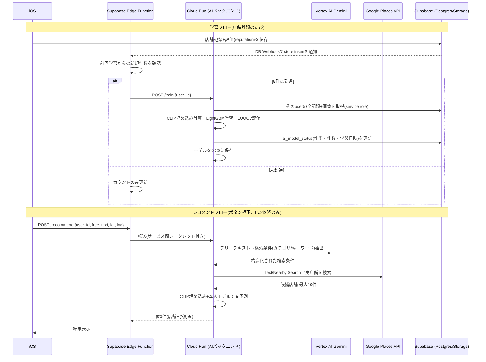

# AIバックエンド 要件定義書

元ネタ: Notion「AI育てる機能」(https://app.notion.com/p/4039efa583a080bdb8ecd23437c8308c)
関連: 既存プロトタイプ `feat/train-recommend-model` ブランチの `mogumap_clip_lgbm/mogumap_clip_lgbm/`(CLIP+LightGBMのローカル実装)。
関連メモ: 「AIを育てるタブの確定仕様」(育成ページUI側の確定事項)。

2026-10-24、keishiさんとの擦り合わせで以下を確定した。未決定の項目は8章に残す。

## 1. 背景・目的

現在のアプリはフレンドのおすすめを見るだけの受動的な機能のみ。能動的にお店をレコメンドする機能を追加し、「入力するほどAIが自分向けに育っていく」という動機付けを作る。

## 2. スコープ

**対象(本フェーズ)**
- ユーザーごとの個別AIモデルの学習・保存・再学習
- フリーテキスト(「ラーメン食べたい」等)からのレコメンド(候補生成→個人モデルでスコアリング→上位3件)
- 育成ページに表示する学習件数・モデル性能の算出

**対象外(今回スキップ、将来拡張)**
- フレンドとの共通店舗選出(最大幸福度) — 一旦スキップと確定
- Lv.3到達後の追加の動機付け(育成ページ側で既に対象外と確定済み)

## 3. 全体アーキテクチャ

- **コードの配置**: このモノレポ内(`mogumap_clip_lgbm/`)で管理。iOSアプリとは別デプロイパイプラインを持つが、別リポジトリへの分離はしない。
- **ホスティング**: Google Cloud Run(コンテナ)。CLIP(sentence-transformers/torch)など重い依存に対応しやすく、Cloud Functionsよりタイムアウト/メモリの制約が緩い。
- **モバイル⇄バックエンドの経路**: iOSはCloud Runを直接呼ばず、Supabase Edge Function経由のプロキシを通す。APIキーをアプリ内に埋め込まない。

## 4. コンポーネント別要件

### 4.1 AIモデル方式(最重要の決定事項)

**ユーザーごとに完全に個別のLightGBMモデルを学習・保存する**(Notion仕様通り)。

- 特徴抽出(CLIP: `sentence-transformers/clip-ViT-B-32`)は全ユーザー共有・凍結モデルとしてCloud Runインスタンスにキャッシュ。CLIP自体は学習しない。
- 回帰モデル(LightGBM)だけがユーザーごとに別々。入力特徴は既存プロトタイプの`featurize()`を踏襲するが、カテゴリ特徴量は実際のアプリが使う**`PlaceCategoryClassifier`の13分類**(和食/ラーメン・麺類/焼肉・肉料理/中華/カレー/アジア・エスニック/洋食・西洋料理/ファストフード・食堂/カフェ・喫茶/パン/スイーツ/居酒屋・バー/その他)に合わせる。プロトタイプの6種(japanese/italian/ramen/cafe/chinese/other)は仮置きだったため置き換える。

**コールドスタート(Lv.1: 登録0〜4件)の扱い**:
- LightGBMは学習データが少なすぎて学習できないため、**モデル未完成のまま「レコメンド不可」**とする。
- 育成ページには「あとX件でAIが育ちます」のみ表示し、レコメンドボタンは出さない/無効化。
- 5件に到達して初めてモデルが学習され、レコメンド機能が使えるようになる。

### 4.2 学習トリガー

**5件追加されるごとに再学習+評価を行う**(都度学習ではなく、1件登録ごとにEdge Functionでカウントし、5の倍数に達したタイミングでCloud Runの`/train`を非同期起動)。

### 4.3 候補店舗生成(レコメンドフロー)

希望するUXは「ムード入力→LLMが候補店を10件出す→個人モデルでスコアリング→上位3件表示」。幻覚対策として以下の2段構成にする:

1. ユーザーのフリーテキスト(「行きたい場所・食べたいもの」)を**Vertex AI Gemini**に渡し、検索条件(カテゴリ/キーワード/価格帯/雰囲気)に変換するだけに限定する。**LLMに店名を直接生成させない**。
2. 抽出した条件+ユーザーの現在地で**Google Places Text/Nearby Search**を呼び、実在する候補店舗を最大10件取得する(既存`PlacesClient.swift`のロジックに相当する処理をサーバー側Pythonに実装)。
3. 取得した10件を本人のLightGBMモデルで★予測し、上位3件を返す。

Gemini選定理由: Cloud Runと同じGCPプロジェクト内で認証・課金が一元化でき、将来Google Maps関連のグラウンディング機能を使う余地も残る。

### 4.4 モデルの保存・性能評価

- モデル実体: Cloud Runはステートレスなので`gs://<bucket>/models/{user_id}/model.joblib`としてCloud Storageに保存。
- 評価方法: 1ユーザーあたりのデータが5〜数十件と少ないため、**5-Foldではなく LOOCV(leave-one-out cross-validation)** を採用(Notionでも未確定と明記されていた箇所。少データでも安定して評価できるLOOCVを技術的な代替として採用)。
- 表示指標: **平均絶対誤差(|予測★ - 実際★|の平均)を「平均誤差 ±0.x★」として表示**。
- 学習メタ情報(件数・性能・学習日時)は新規テーブル`ai_model_status`に書き込み、iOSの育成ページはSupabaseから直接読める(Cloud Runを経由しない)。

### 4.5 認証・セキュリティ

- iOS → Supabase Edge Function: 既存のSupabase認証(ユーザーのアクセストークン)。
- Edge Function → Cloud Run: サービス間シークレット(Secret Manager管理)。詳細な方式は8章の残課題。
- 既存プロトタイプの`MOGUMAP_API_KEY`ヘッダ認証はローカル検証用。本番ではEdge Function経由に統一し、APIキーをアプリ内に置かない。

## 5. APIエンドポイント(ドラフト)

| メソッド | パス | 用途 | 認証 |
|---|---|---|---|
| GET | `/health` | 死活監視 | なし |
| POST | `/train` | 指定ユーザーのモデルを再学習(既存プロトタイプの`/train`をユーザー単位に変更) | サービス間シークレット |
| POST | `/predict` | 候補店舗リストを渡して★予測(内部利用、既存プロトタイプ互換) | サービス間シークレット |
| POST | `/recommend` | フリーテキスト→候補生成→予測→上位3件(iOSが実質叩く窓口、新設) | サービス間シークレット |

## 6. データモデルの変更点(既存Supabaseスキーマとのギャップ)

現在の`store`テーブル(`reputation`, `category`, `google_place_id`, `latitude`/`longitude`, `memo`, `repeat_num`)には、既存プロトタイプの特徴量に必要な以下が**欠けている**:

- `google_rating`(Google公開平均★)
- `price_level`
- `review_count`

**方針**: `google_place_id`から都度Google Places Details APIを呼ぶのではなく、店舗登録時にPlaces Details結果をスナップショットとして保存するカラムをマイグレーションで追加する(学習時の外部API依存・コストを減らし、オフラインでの再学習も可能にする)。

追加で必要なテーブル:
- `ai_model_status`(user_id PK, record_count, last_trained_count, mean_abs_error, model_gcs_path, trained_at)

## 7. 非機能要件

- **コスト**: ハッカソン規模のためCloud Runはmin-instances=0を基本とする(デモ直前だけ1に上げるかは要確認)。
- **レイテンシ**: `/recommend`はGemini→Places→CLIP→LightGBMの直列呼び出しのため数秒〜十数秒想定。iOS側はローディング表示が必須。
- **プライバシー**: CLIPはローカル推論(sentence-transformers)のため画像を外部送信しない。Geminiへはフリーテキストのみを渡し、画像は送らない。

## 8. 確定事項(2026-10-24、デモ日程「明日」を踏まえて決定)

- **GCPプロジェクト**: `mogu-map-512614`(既存プロジェクトを再利用)。請求先アカウント「請求先アカウント1」を紐付け。
- **Edge Function ⇄ Cloud Run間の認証**: 固定の共有シークレット(`AI_BACKEND_API_KEY`、GCP Secret Manager `ai-backend-api-key`)。IAM/IDトークン検証は時間の都合で見送り、Cloud Runは`--allow-unauthenticated`で公開しアプリ層のAPIキーのみで保護する(今回のデモ向けの判断。本格運用時はIDトークン検証への移行を検討)。
- **GCSバケット**: `gs://mogu-map-ai-models`(モデルファイル保存先、`models/{user_id}/model.joblib`)。
- **Cloud Runのmin-instances**: 0(コスト優先)。デモ直前にコールドスタートが気になる場合は一時的に1へ変更。
- **Vertex AI Gemini**: `location=global`でのみ`gemini-3.8-flash`が利用可能だった(`asia-northeast1`/`us-central1`では404)。2026-10-24時点の実測。
- **Google Places API**: APIキーの`api-target`は`places.googleapis.com`(`places-backend.googleapis.com`ではない)。
- **`store`テーブルへのカラム追加**: 今回のマイグレーション(`20261024100000_ai_backend_schema.sql`)に含めた。
- **ハッカソンのデモ日程**: 明日。このため認証方式等を上記の通り簡略化した。

## 9. 将来拡張

- フレンドとの共通店舗選出(最大幸福度の選出) — 今回スキップ
- Lv.3到達後の追加の動機付け — 育成ページ側の既存決定により今回対象外
